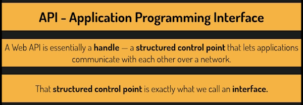
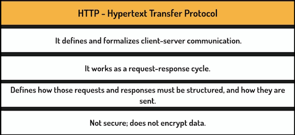
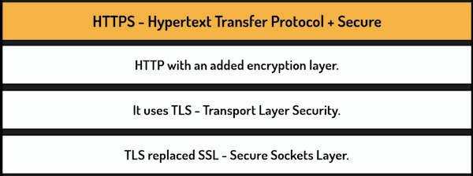
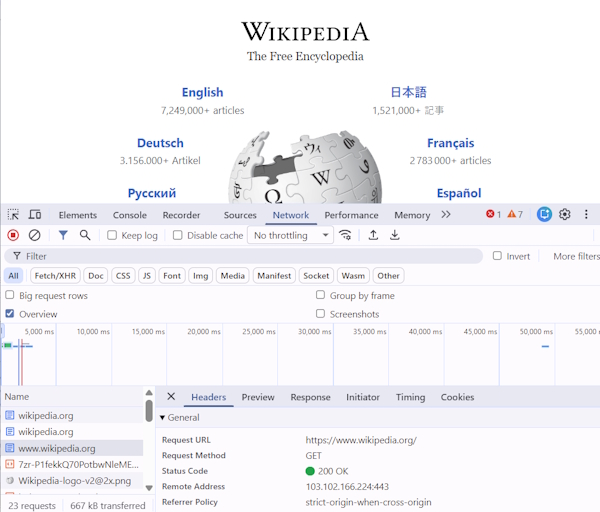
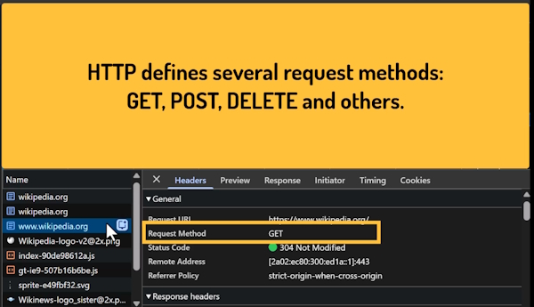
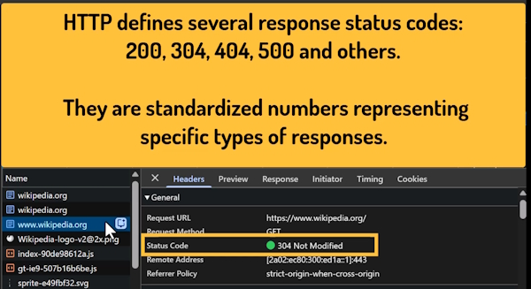
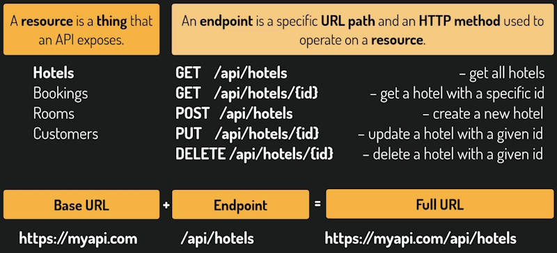
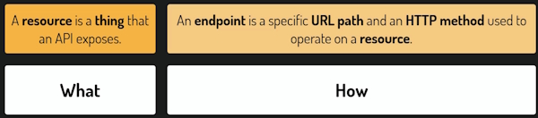
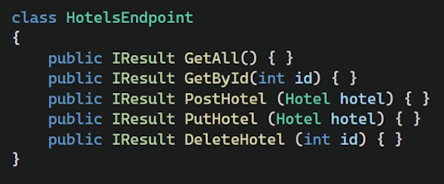
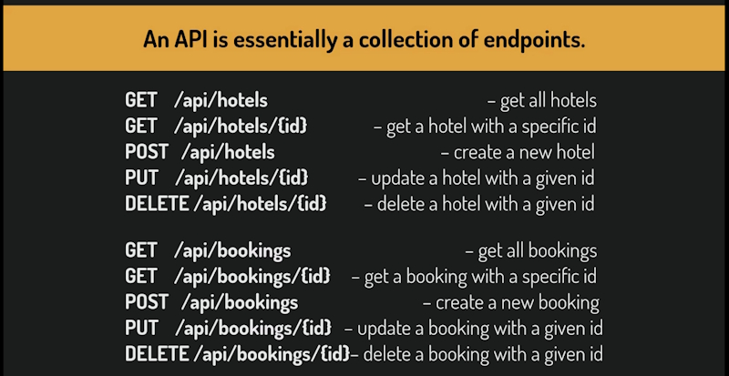

# The Basics of APIs

## Application Programming Interface

### What an Application Programming Interface actually means

A web API is essentially a **handle**, a **structured control point** that lets applications communicate with each other over a network.

That **structured control point** is exactly what we call an **interface**.

And web APIs are not the only kind of APIs that exist.

Any structured protocol for communicating with an application is an API.

For example, when we write a program that needs to launch a Windows application, we use the Windows API.

We call a function that tells Windows to open this application.

If Windows did not expose an API, we would have no way of communicating that from our own code.

## HTTP - How Web communication works

HTTP isn't secure so HTTPS was created to add a secure layer.

## Web communication in action

There are a number of request methods that are available to us.

We get status codes from the request to show if the request was successful or not.

In the case above a status code of **304** means that the web page was cached and successful. Normally you would see a status code of **200** meaning successfully received.

## Requests and Responses

The client sends a **Request** to the API. In the example it is a ``GET`` request for a book with the ``Id`` of 1.

The **Response** is sent back to the user as JSON.

## Resource vs Endpoint

A **Resource** is a **thing** that the API exposes. For example a resource could be a hotel, bookings, rooms,  customers, etc.

An **Endpoint** is a specific **URL path** and an **HTTP method** used to operate on a **resource**.

We could also have another set of endpoints that work on bookings.

Another conceptual way to look at resources verses endpoints is that a resource exposes **what** an API exposes and an endpoint is **how** we manipulate that resource.

When building an API we typically group our endpoints related to a give resource in one class and write one method for each endpoint.

These keep the code organised.

An API is essentially a collection of endpoints that form a contract that tell anybody coding the API exactly what operations are available.

The API documentation also allows the user to see how the endpoints are grouped and used. For this we will use Swagger.
