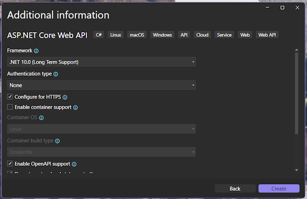
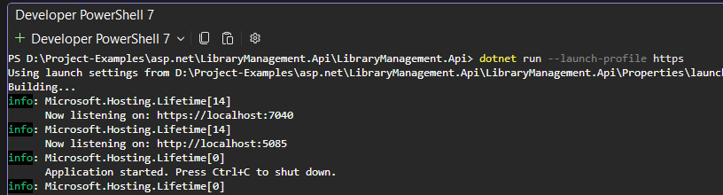

# Project Setup and Overview

## Creating a new ASP.Net Core Web API project

Call the project **LibraryManagement.Api**.



Make sure to **Enable Open API support**. We will use this for documentation.

We will use both **Controllers** and **Minimal API** but for now turn Controllers off and go with the Minimal API option.

## Project structure overview

We have a file named ``LibraryManagement.Api.http`` that contains endpoints.

```bash
@LibraryManagement.Api_HostAddress = http://localhost:5085

GET {{LibraryManagement.Api_HostAddress}}/weatherforecast/
Accept: application/json
```

## Understanding the Program.cs file

This is the heart of our application. It is setup to run our application with one **Minimal API** endpoint.

The first method call in ``Program.cs`` is to call:

```bash
    var builder = WebApplication.CreateBuilder(args);
```

``CreateBuilder`` is crucial to our application and it is where we register all services our application needs. Things like database access and mapping tools, etc.

For now the only service that is registered is ``AddOpenApi``

```bash
    builder.Services.AddOpenApi();
```

This is used to document the API. Documentation will be generated automatically describing our endpoint. We will use tools to view our API.

Once all services are registered we will call ``Builder.Build()``:

```bash
    var app = builder.Build();
```

This finishes the configuration phase and create the actual application object.

A good thing to remember is that everything before ``Builder.Build()`` is service registration.

The next statement is used if were are in the Development cycle.

```bash
    // Configure the HTTP request pipeline.
    if (app.Environment.IsDevelopment())
    {
        app.MapOpenApi();
    }
```

In this example we will run ``app.MapOpenApi()`` if we are in development.

The first ``MapOpenApi()`` statement registers the service (Be ready to use it) and the last exposes the OpenAPi endpoint (Use it). This statement is only useful to us in the Development process.

The next statement ensures that all **http** requests are redirected to **https**.

```bash
    app.UseHttpsRedirection();
```

This completes the technical setup and the next section is our sample endpoint.

First, we create some sample data:

```bash
var summaries = new[]
{
    "Freezing", "Bracing", "Chilly", "Cool", "Mild", "Warm", "Balmy", "Hot", "Sweltering", "Scorching"
};
```

Next is our sample endpoint named ``weatherforecast``.

```bash
app.MapGet("/weatherforecast", (HttpContext httpContext) =>
{
    var forecast = Enumerable.Range(1, 5).Select(index =>
        new WeatherForecast
        {
            Date = DateOnly.FromDateTime(DateTime.Now.AddDays(index)),
            TemperatureC = Random.Shared.Next(-20, 55),
            Summary = summaries[Random.Shared.Next(summaries.Length)]
        })
        .ToArray();
    return forecast;
})
.WithName("GetWeatherForecast");
```

The next statement runs our sample endpoint:

```bash
    app.Run();
```

This means that the program keeps running and waiting for requests and only stops when we end it.

**Note:** any code that we write after ``app.Run()`` won't be executed so make sure that all of your code is before this statement.

## Running your Api and sending your first request

We are going to open the Integrated terminal to run our application with this command (make sure you are in the correct directory):

```bash
    dotnet run --launch-profile https
```

This will start the application. When you run this not a lot seems to happen but the application is running in the background. We are actually connected to ``localhost`` where our API is hosted.



There are 2 localhost settings but we are only interested in the **https** setting. The port number states which application or service on a machine should receive incoming traffic requests from an incoming service. Multiple applications can run on a machine at the same time and the port identifies the application that is currently running.

If you enter the following address:

> http://localhost:5085

Notice that it changes to:

> https://localhost:7040

This is because of the **https** redirection statement in ``Program.cs``. 

Still there is nothing showing and this is because ``https://localhost:7040`` is the root address of our API. By itself it doesn't return anything. 

To actually use the API we need to send the request to a specific endpoint. What endpoint is exposed? There is only one in our ``Program.cs`` file and that is ``/weatherforecast``.

To consume our sample endpoint:

> https://localhost:7040/weatherforecast

This produces a JSON array of objects that show temperatures. This is basically raw data that might be sent to a web page that produces a graphical weather chart.

To close the application just press ``CTRL-C`` in the terminal.

## Using the console

You can see our application running in the console. It is showing the ports that it is running on and that the application has started. we can also add ``Console.WriteLine()`` statements to ``Program.cs`` to give us more information.

Add this statement before ``app.Run()``:

```bash
Console.WriteLine("Started the application...");

app.Run();
```

> Started the application...        
> info: Microsoft.Hosting.Lifetime[14]      
>       Now listening on: https://localhost:7040        
> ...

This is alright for quick testing but in future we will register a logging service.
