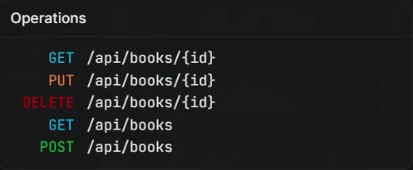
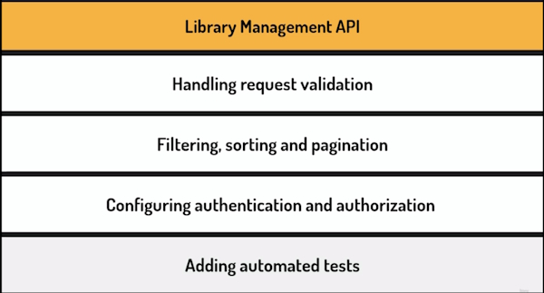
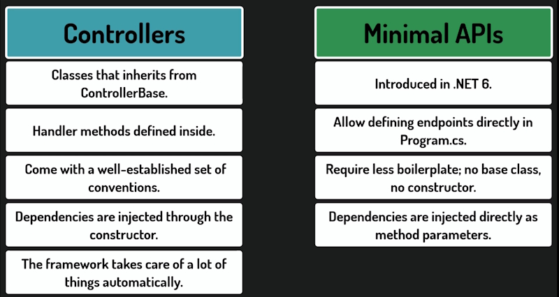
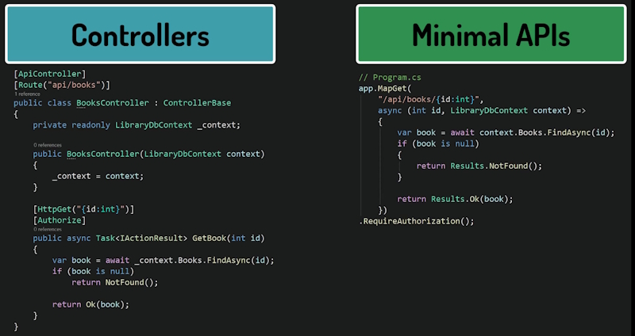
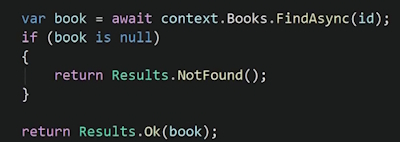
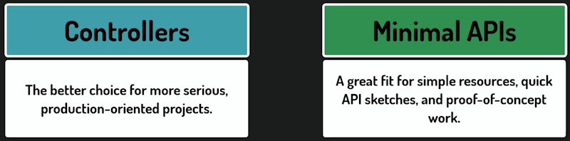
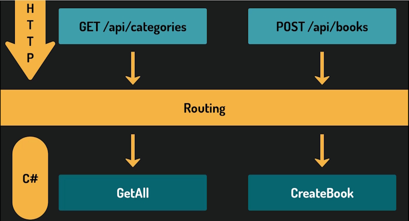
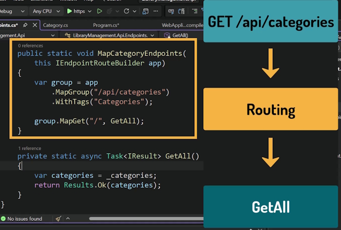

# Defining The First API Endpoint

## The API we will build

We are building a Book library API.

We Will build a set of API endpoints that are specific URLs which accept **Requests** and return **Responses** for our particular action.

These are the Book entity endpoints.



We will have sets of endpoints for Books, Authors, Loans and more. The data will be stored in a PostGresSQL database.

On an online system this would be done through a set of web pages but in our case we will be entering data sending the requests ourselves. We will use ``Scalar``, an online documentation system to enter the data.

Building API endpoints is the heart of building an API but we will be doing more than that.



## Minimal APIs Vs Controllers

Minimal APIs are usually used for smaller projects. Creating a number of endpoints in Minimal APIs can get messy very quickly. We end up creating a number of classes for different endpoints to reduce this clutter.



### An example of a Controller and a Minimal API endpoint

The endpoints in the example below do exactly the same task. They return a Book based on a Book Id. One is a Controller and the other is a Minimal API endpoint.



**Note:** that the code to get a Book based on its Id is essentially the same for the Controller and Minimal API endpoints.



When you use Controllers over Minimal APIs depends on a number of conditions.



## Defining the first entity

We will start with the simple approach of Minimal APIs.

Create an **Entities** directory.

Crate a class named ``Category``.

```bash
    public class Category
    {
        public int Id { get; set; }
        public string Name { get; set; }
    }
```

**Note:* we get a warning on the ``Name`` property. The ``Name`` property is a reference type of ``string``. We could make it a nullable type:

```bash
    public string? Name { get; set; }
```

There is nothing to stop a user from creating a ``Category`` type with only an ``Id`` value. This would be redundant because a ``Category`` would have to have a name.

We can fix this by adding the ``required`` keyword to the property.

```bash
    public required string Name { get; set; }
```

Now the compiler will not allow the user to create a ``Category`` without a ``Name`` value.

Why don't we use required for the ``Id`` value as well? We don't need to because once we start using a database Entity Framework will automatically generate an ``Id`` for us.

The ``Category`` class is relatively simple and we could create a ``Record`` to hold the ``Category`` information for us but we need to create a class for Entity Framework needs to be able to create a parameter-less constructor to be usable.

With this Entity defined we can now write our first endpoint.

## Defining the first endpoint

Remove the sample endpoint from ``Program.cs``.

Now create an **Endpoints** directory. In it we create a ``CategoriesEndpoints`` class for our endpoints.

Also make this class **static**. Why? because we never need to make an instance of this class. It is just a container for methods. A static class doesn't use a constructor and we don't need one. All dependencies will be injected into our methods.

Static classes shouldn't hold any state of its own and this prevents accidents from happening.

This class will never be a dependency for another class so we don't need to implement an Interface. Also because nothing depends on this class we will never have to mock the class in tests.

## Defining our first endpoint using Get

```bash
    private static async Task<IResult> GetAll()
    {
        var categories = // Get categories from storage.
        return Results.Ok(categories);
    }
```

The method is **private** because it doesn't need to be accessed from outside this class. We will see soon how it gets exposed to the API.

It is **static** because the class itself is static and can only contain static members.

**async** is used because endpoints often use asynchronous operations when reading from the database and we don't want to block the thread while we are waiting.

The return type is **Task** of **IResult**. **IResult** is an interface that represents the HTTP response that we want to send back. To build our response we need to use the static ``Results`` class which provides methods like ``Results.Ok()``. That method returns a result implementing ``IResult`` and sets the HTTP code to **200** meaning that the response was successful.

We will use a ``List`` to store our data.

```bash
    public static class CategoriesEndpoints
    {
        private static List<Category> _categories =
        [
            new Category { Id = 1, Name = "Biography" },
            new Category { Id = 2, Name = "Novel" }
        ];
        
        private static async Task<IResult> GetAll()
        {
            var categories = _categories;
            return Results.Ok(categories);
        }
    }
```

**Note** that Visual Studio has greyed out the ``GetAll()`` method because it is not being used.

To be able to use this class we need to register it explicitly. Once we do it becomes a handler method for handling a specific HTTP request. Every endpoint that we create will follow the same process from now on. One method for one endpoint.

## Registering the endpoint

Open the **Endpoints Explorer** in Visual Studio.

> View --> Other Windows --> Endpoints Explorer

This is only used in Visual Studio and is only used for this example. In future we will use ``Scalar`` which is better.

It shows all endpoints currently registered in our application.

Our ``getAll()`` method is just a regular C# method at this point. ASP.NET Core has no idea it exists. Let's fix it.

To register our endpoint, we will add a dedicated public method to our ``CategoriesEndpoints`` class.

```bash
    public static void MapCategoriesEndpoints(this IEndpointRouteBuilder app)
    {
        var group = app
            .MapGroup("/api/categories")
            .WithTags("Categories");
        group.MapGet("/", GetAll);
    }
```

The ``MapCategoriesEndpoints()`` method is public and static.

Public, because it will be called from ``Program.cs``and static, because the class is static.

It is an extension method on ``IEndpointRouteBuilder``. we use the **this** keyword in front of the parameter.

In short, extension methods let us add methods to a type, even if this type is defined outside our codebase.

Or like in this case, when a type cannot have full-bodied methods defined, like the interface we are using here.

With this method defined like this, we will be able to call it on any object implementing this interface, just like it was defined in this object's type.

Before we explain what exactly this ``IEndpointRootBuilder`` is, we need to understand routing.

### Routing

**Routing** is the mechanism that maps an incoming HTTP request, so the method and URL, to the specific code that should handle it.

In our case, the **GET** request with this URL should be redirected to this ``getAll()`` method.



In our case a request like ``GET /api/Categories`` should be routed to the C# ``GetAll()`` handler. Routing is a key part of work on an API. It is the framework on what request gets routed to what method.

We must tell the framework which requests get redirected to which methods.

And this is exactly what we can use the ``IEndpointRootBuilder`` for.

It is an interface from ASP.NET Core that represents the part of the application responsible for routing.

In other words, an object that decides which method gets called when a request comes in. As it turns out, we already have an object implementing this interface.

In ``Program.cs``, we have an object called ``App``, which is of type ``WebApplication``.

If we look at its implementation we see that it implements ``IEndpointRouteBuilder`` which is the object we will use when calling the extension method we defined.

```bash
    group.MapGet("/", GetAll);
```

And here is where we actually configure the routing with a call to the ``MapGet()`` method.

This method registers our ``getAll()`` method as the handler for ``GET`` requests.

We could call this method in our ``Program.cs`` but it would get messy fast. It is better to call an extension method.

This is the standard pattern for organizing minimal API endpoints.

It keeps ``Program.cs`` clean, while still giving us full access to the routing system.

Let's understand this method.

``MapGroup`` creates a root group.

Every endpoint we register inside this group will automatically have ``api/categories`` as the beginning of its URL.

Right now, we only have one endpoint, so the benefit is not obvious yet. But we will soon add more, and all of them will share the same prefix, without us having to repeat it every time.

The ``withTags()`` method adds a tag to the group. **Tags** are used by documentation tools. We will see this clearly once we set up Scalar. They control how endpoints are grouped and displayed in the API documentation.

In our case, all endpoints related to categories will appear together under the Categories label.

Now the ``MapGet()`` method.

The first argument is the root for this specific endpoint.

A single forward slash means we are not adding anything on top of what the group already defines.

And that makes sense here, because this endpoint returns all categories, and does not need any additional information in the URL, like for example the ``Id``.

The full URL will simply be ``api/categories``. 

Later, when we add an endpoint that fetches a single category by Id, the root will look different something like ``/id`` but for now, a slash is all we need.

The second argument is the method to call when the request comes in.

So in short, this configures routing in this way. When a GET request comes in with an URL equal to ``api/categories``, the ``GetAll`` method will be called.



Now we need to call the ``MapCategoryEndpoints`` method from ``Program.cs``.

First, we need to add a using directive at the top of the ``Program.cs`` file.

```bash
    using LibraryManagement.Api.Endpoints;
```

And then, before ``app.run()`` we should call our method.

```bash
    ...
    app.UseAuthorization();

    app.MapCategoriesEndpoints();

    app.Run();
```

This is the line that actually connects everything together. Without it, the registration method we just wrote would never be called. Let's rebuild the project and check the Endpoints Explorer again. Our endpoint is now visible.

The framework knows it exists and how to route requests to it.

Very soon, we will run the application and send the first request to this endpoint.
