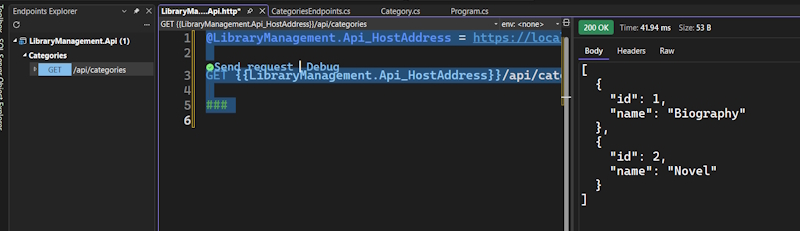
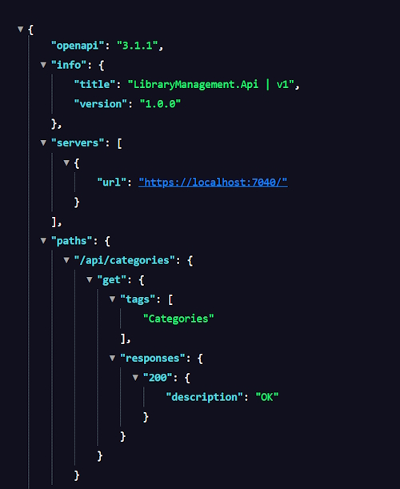
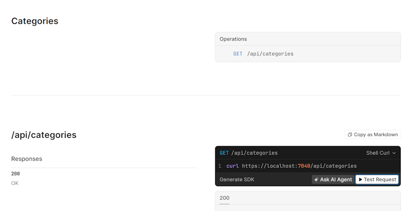
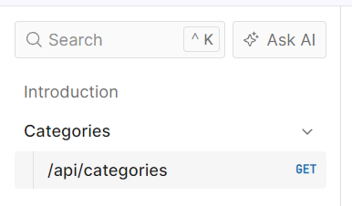

# Testing the API manually

## Calling the API from the IDE

Type in the API call

```bash
    https://localhost:7040/api/categories
```

Returns:

```bash
[
    {
        "id": 1,
        "name": "Biography"
    },
    {
        "id": 2,
        "name": "Novel"
    }
]
```

Using the browser is fine for simple **Get** requests but we will need something more substantial for Update Posts, etc.

In your Solution you can see a ``LibraryManagement.Api.http`` file. This file can used to send requests to an API without using the browser or any external tools, without even leaving the IDE. And since it is just a text file, we can save the requests here.

My HTTP file looks like this:

```bash
@LibraryManagement.Api_HostAddress = http://localhost:5085


###

```

The first line defines a reusable variable that can be referenced anywhere in the file. Notice the **@** symbol used for variable declaration. This variable stores the base URL of the local server.

The next line ``###`` is an endpoint separator that shows where one endpoint ends and another starts.

In the Endpoints Explorer right-click on ``/api/categories`` and select ``Generate Request``. This will add the endpoint to the HTTP file.

```bash
@LibraryManagement.Api_HostAddress = https://localhost:7040

GET {{LibraryManagement.Api_HostAddress}}/api/categories

###

```

Once you have added this you can click on the ``Send request`` link that appears above the endpoint to run it as shown below.



**Note** in Visual Studio Code you would have to manually enter the endpoint. Also install the **REST Client** extension and that will allow you to run the endpoint.

## The importance of endpoint registration

```bash
    ...
    app.UseAuthorization()

    app.MapCategoriesEndpoints()

    app.Run();
```

If you forget to register ``MapCategoriesEndpoints()`` and try to reach an endpoint you will get a **404** error.

## OpenAPI documentation

Calling endpoints from an HTTP file is a perfectly valid technique and worth knowing. It is the most basic way to send requests to our API, with no extra tools required.

In Visual Studio Community, we can generate requests automatically, but if anything changes in our endpoint definition, we would have to regenerate them.

In Visual Studio Code, we have to write every request by hand and update it manually whenever something changes.

As our API grows, we need something better. A proper interface where we can see all our endpoints in one place and test them interactively.

Many popular tools for testing and exploring APIs use ``OpenAPI`` documentation and build an interactive interface based on it.

As a quick reminder, ``OpenAPI`` is a standard format for describing what endpoints API exposes, what inputs they accept, and what they return.

While we were setting up the project, we chose an option to enable ``OpenAPI`` documentation.

Choosing that option during project setup installed the relevant packages and added those lines to ``Program.cs``.

```bash
    ...
    builder.Services.AddOpenApi();
             
    var app = builder.Build();

    // Configure the HTTP request pipeline.
    if (app.Environment.IsDevelopment())
    {
        app.MapOpenApi();
    }
```

**Note:** I had to manually enter the following statement. Without it the documentation wouldn't work.

```bash
    builder.Services.AddOpenApi();
```

We can access this documentation by:

```bash
    https://localhost:7040/openapi/v1.json
```



It's not very readable for humans, but if we look closely, we can see it contains the definition for our category's endpoint. And the supported method, the tags, the possible responses.

This documentation may be hard to read directly, but it is perfect for other tools. Tools that can read it, interpret it, and present a nicely formatted interface based on that data.

And what makes it even better is that this documentation is updated automatically as we work on the API.

When we add a new endpoint, it will appear here automatically the next time the application runs.

## Setting up Scalar

Scalar is a modern open-source API documentation tool that generates an interactive interface from the OpenAPI specification.

Scalar reads from the OpenAPI document every time the app runs, it always reflects our current endpoints. There is nothing to update manually.

You may also have heard of Swagger UI. For many years, it was the standard tool in the .NET ecosystem, included by default in every new Web API project.

It did the same job, read the open API specification, and present an interactive interface in the browser. In .NET 9, Microsoft removed it from the default project templates, and Scalar became a natural replacement.

It integrates with ASP.NET Core with just a few lines of code, and is available as a NuGet package.

To install **Scalar.AspNetCore** use the Nuget Package Manager.

But we can also use the CLI because it works the same way in Visual Studio Code.

> dotnet add package Scalar.AspNetCore

Scalar is now installed, but we need to configure it.

In ``Program.cs``.

At the top of the file, we need to add a ``using`` directive so that the Scalar extension methods are available.

```bash
    using Scalar.AspNetCore;
```

We don't need Scalar in production so add it to the ``IsDevelopment()`` section.

```bash
    // Configure the HTTP request pipeline.
    if (app.Environment.IsDevelopment())
    {
        app.MapOpenApi();
        app.MapScalarApiReference();
    }
```

Test it:

> https://localhost:7040/scalar/v1



## Using Scalar

Scalar uses the ``Categories`` Tag that we set up to group all Categories endpoints.

```bash
    var group = app
        .MapGroup("/api/categories")
        .WithTags("Categories");
```

Relates to:



When we add ``Books`` endpoints they will be grouped next to Categories.

## Understanding the launchSettings.json file

The launch settings file configures the way our application starts, which URL it listens on, which environment it runs in, and whether it opens in browser automatically.

``launchSettings.json`` is only used for development. We can change our settings to run Scalar when we run our API.

Change ``launchBrowser`` to ``true``.

Add the ``launchUrl`` key with a value of ``scalar/v1``.

```bash
    "https": {
      "commandName": "Project",
      "dotnetRunMessages": true,
      "launchBrowser": true,
      "launchUrl": "scalar/v1",
      "applicationUrl": "https://localhost:7040;http://localhost:5085",
      "environmentVariables": {
        "ASPNETCORE_ENVIRONMENT": "Development"
      }
    }
```

Now when you run the project it will launch the browser with Scalar.

### Run your project in Visual Studio Code

We can run the API with:

> dotnet run --launch-profile https

This is a long command and in VS Code we can change the command through the launchSettings.json file.

Swap the ``http`` and ``https`` sections around so the ``https`` section is on top. Now use:

> dotnet run

**Note:** Also change the sections in Visual Studio as well if you want to run the API from the command line. You also have to enter the "scalar/v1" section to your Url to get it to work.
