# Rest APIs

## REST

**REST** stands for Representational State Transfer.

It is a set of architectural principles for building networked systems. 

REST is not a protocol it's an architectural style.

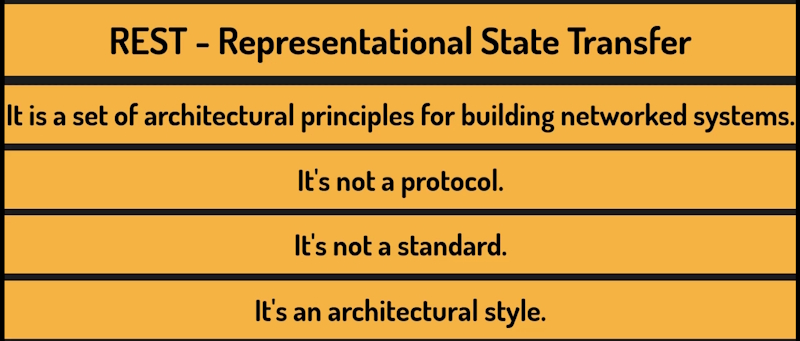

REST is a set of guidelines that describe how a well-designed system should behave.

Following these principles leads to APIs that are predictable, easy to use, and easy to maintain.

### Core principles

#### 1. Client-Server separation

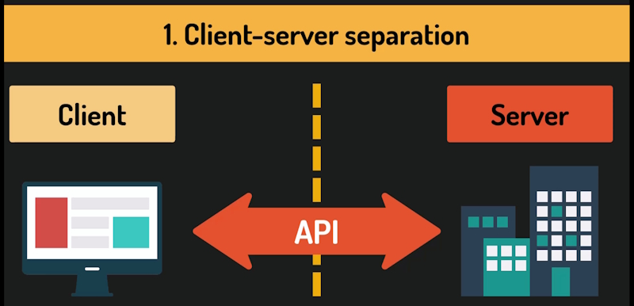

The client and the server are **independent** from each other.

The client, which could be a web browser, a mobile app, or another service, doesn't know how the server stores or manages its data.

The server doesn't know how the client displays or processes what it receives.

They communicate only through the **API**.

This separation means we can change the front-end without touching the back-end, and vice versa. It keeps things modular and maintainable.

#### 2. Statelessness

It is one of the most important ideas in REST, and it has real consequences for how we design our APIs.

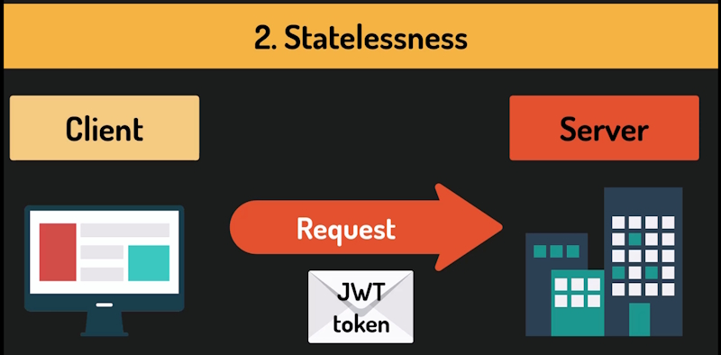

Statelessness means that every request from the client to the server must contain all the information needed to process that request.

The server **does not** store any session state between requests. It **does not** remember who you are from one request to the next.

For example, when implementing authentication in our APIs, we often use ``JWT tokens``, which are compact strings that carry information about the user in a self-contained format.

Every time a client makes a request to a protected endpoint, it must send that token along with the request. The server doesn't remember that the client was logged in. It checks the token each time.

That's statelessness in practice.

This might sound like a limitation, but it's actually what makes REST APIs scalable because the server holds no session state, any server in a cluster can handle any request. There's no need to route a client to the same server every time.

#### 3. Uniform interface

This is the most characteristic feature of REST, and it's what makes REST APIs feel intuitive.

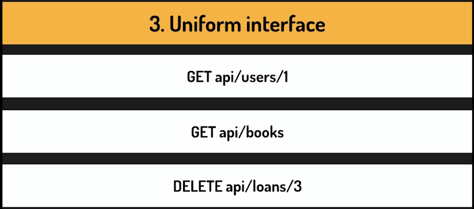

A uniform interface means that the API behaves in a consistent, predictable way.

If you understand the pattern, you can use the API without reading every page of documentation.

The things our API exposes, are identified by URLs and the action we want to perform is expressed through the HTTP method.

For example in our endpoint:

``/api/categories`` is the Resource URL.

``GET`` is the HTTP method and describes what we want to do with the resource.

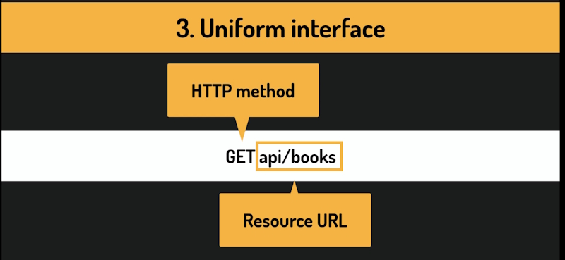

Some more examples:

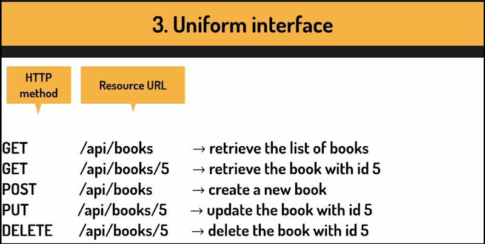

This is the core of a RESTful interface design.

#### 4. Layered system

The client doesn't need to know whether it's communicating directly with the server that 
handles its request, or whether there are other layers in between.

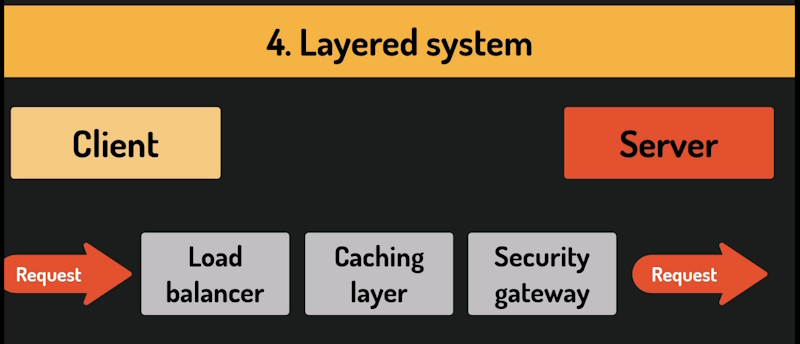

The client doesn't know that the Resource it has requested could be going directly or is being sent to a load balancer, a caching layer, or a security gateway.

This makes it easy to add infrastructure around our API without changing the API itself.

Luckily for us, this is something that many web frameworks handle for us. For example, in ASP.NET, this principle shows up in the middleware pipeline.

When a request comes in, it passes through a series of middleware components. One handles authentication, another error logging, another response compression. Each component does its job and passes the request along.

The client knows nothing about this chain, and adding or removing a middleware layer doesn't affect the others.

#### 5. Cacheability

Caching means storing a copy of a response so that the same data can be returned again without repeating the work of generating it.

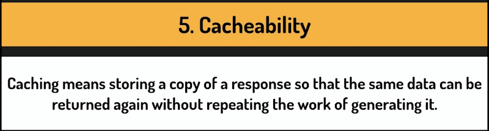

Instead of hitting the database and running the same query every time, the result is saved on the server, on the client, or somewhere in between and reused until it's no longer valid.

The REST principle says that responses should indicate whether this is allowed.

If a client asks for the same data repeatedly, and that data hasn't changed, caching it means the server doesn't have to process the same request over and over. This improves performance and reduces load.

``HTTP`` has built-in mechanisms for this. Headers like Cache Control and ETag. And many API frameworks support them out of the box. In practice, ``GET`` requests for stable data are good candidates for caching.

A request that retrieves an author's biography doesn't need to hit the database every single time.

Requests that modify data, ``POST``, ``PUT``, ``DELETE`` are never cached.

Not every API that calls itself a REST API actually follows all the principles. And that's fine. In real-world development, you apply these guidelines with judgment. 

The goal is to build an API that is consistent, predictable, and easy to work with.

## HTTP Response codes

Every ``HTTP`` response includes a three-digit status code. This code tells the client, whether that's a browser, a mobile app, or a tool like Scaler or Postman, what happened with its request.

These codes follow a well-defined standard, and understanding that standard will make us much better at designing APIs that communicate clearly with their clients.

The first digit alone already tells us a lot. HTTP status codes are organized into five categories, each starting with a different digit.

Let's go through them one by one.

Codes in the 100 range are **Informational**.

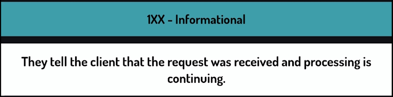

They tell the client that the request was received and processing is continuing. In practice, we almost never deal with these in REST API development. They are handled at a lower level, by the HTTP infrastructure.

You likely never return a 100 code yourself.

Codes in the 200 range mean the request was received, understood, and processed successfully. These are the codes we return when things go well.

**200 OK** is the most common success code.

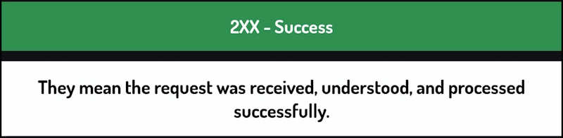

It's the general purpose, everything worked response. When a client requests a list of persons and we return it, that's a 200. When a client asks for a specific person and we find them, that's a 200.

**201 CREATED** is more specific.

We use it when a request results in a new resource being created.

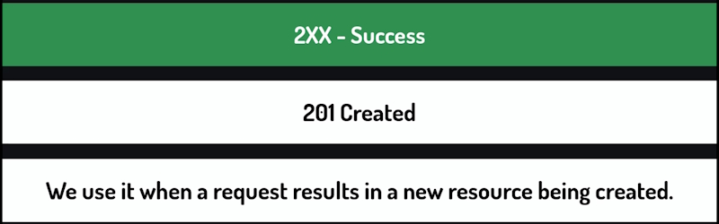

So when a client sends a **POST** request to add a new person and we successfully save them to the database, we should return 201, not 200. The distinction matters because it communicates intent. The client now knows a new resource exists.

**204 NO CONTENT** means the request was successful, but there is nothing to return in the response body.

The typical example is a ``DELETE`` request. When a client deletes a person, the operation succeeds, but there is no data to send back so we return 204, success with an empty body.

Codes in the 300 range tell the client that it needs to take an additional step, usually go to a different URL, to complete the request.

The most common ones are 301 MOVED PERMANENTLY and 302 FOUND, sometimes called a TEMPORARY REDIRECT.

These are used more in traditional web applications than in REST APIs. When building an API, we generally don't redirect clients ee just return data.

So like the 100 range, you will not use 300 codes often in your API.

**400 CLIENT ERRORS** mean the request had a problem and the problem was on the client's side.

The server received the request, understood it, but couldn't process it because something was wrong with what the client sent.

**400 BAD REQUEST** is the general, something is wrong with your request, response.

We use this when the client sends data that fails validation. For example, trying to create a person without a name or providing an email address in the wrong format.

**401 UNAUTHORIZED** is returned when a client tries to access a protected endpoint without valid credential.

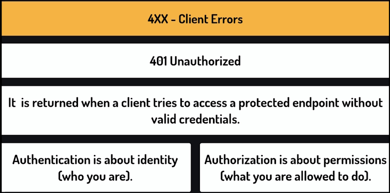

It means, I don't know who you are, please provide credentials. But wait a minute, authentication is about identity, who you are Authentication is about permissions.

So why is it called unauthorized if it's really about authentication? Well, that's the thing the name is misleading and it has led more than a few engineers into some very confusing debugging sessions.

**403 FORBIDDEN** is different from 401.

Here we know who the client is and they are authenticated, but they don't have permissions to perform this action.

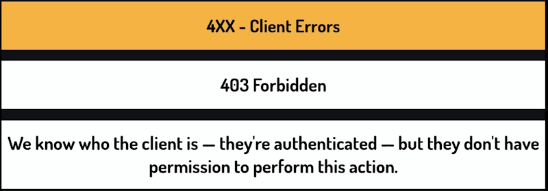

For example, a regular user trying to delete another person's account would get a 403 because that operation is restricted to administrators.

**404 Not Found** means that the requested resource doesn't exist.

**409 CONFLICT** is used when the request can't be completed because it conflicts with the current state of the resource. For example, if a client tries to register with an email address that already exists in the system, that's a conflict.

The request is valid, but the current state of the data prevents it.

Codes in the **500 range** mean something went wrong on the server's side.

The request from the client may have been perfectly valid, but the server just failed to handle it.

**500 INTERNAL SERVER ERROR** is the general purpose code.

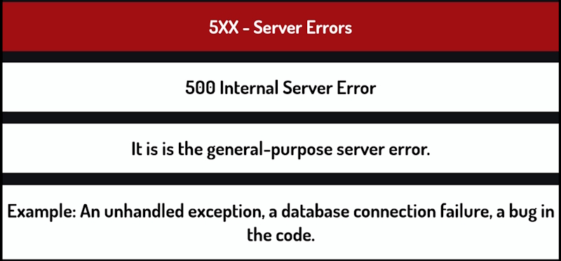

It means something unexpected happened. One unhandled exception, a database connection failure, a bug in the code. We never want to return this intentionally. It's the code that appears when we haven't handled something properly. If it happens, it means us, the developers, have some work to do.

**503 SERVICE UNAVAILABLE** means the server is temporarily unable to handle requests.

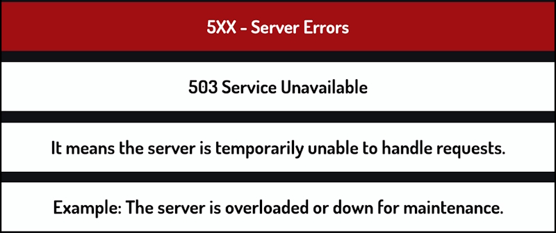

For example, because it's overloaded or downed for maintenance. Not something we return to directly in our application logic, but good to know what it means when you see Internal in it.

### HTTP Response codes summary

Every time we build an endpoint, we should think about what the correct response code should be for each possible outcome.

Success, validation error, missing resource, and so on. One last thing. Using the right status code is not just about following rules it's about making our API easy to work with.

When a client receives a response, the status code is the first thing it sees, before it even looks at the response body.

A well-designed API communicates clearly through its status codes. And that makes life easier for anyone who builds on top of it.

## HTTP Methods - HEAD, OPTIONS, TRACE and CONNECT

HTTP methods, also called HTTP verbs, are a core part of how REST APIs work and using the wrong one can cause real problems, from unexpected errors to data being modified when it shouldn't be.

We are going to look at the most important HTTP methods you will work with as an API developer, what each of them means, and how to choose the right one but before we go through each one, it is worth understanding why they exist at all.

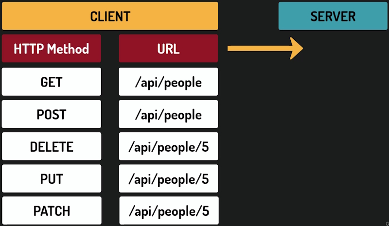

When a client sends an HTTP request to a server, the URL tells the server what resource is being accessed.

The HTTP method tells the server what the client wants to do with it. These are two separate pieces of information. Without HTTP methods, every operation would need to be described in the URL itself.

We would end up with endpoints like getPerson, createPerson, deletePerson. And every API would invent its own naming conventions.

HTTP methods give us a shared vocabulary that every client and every server already understands.

### GET

**GET** is used to retrieve data.

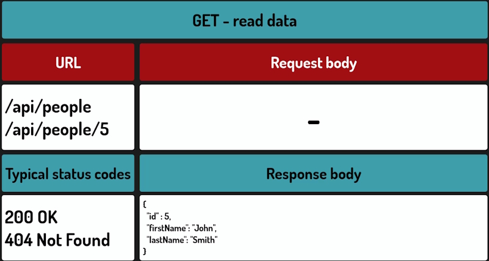

When a client sends a **GET** request, it is asking the server to return a resource. A person, a list of members, a record. The server should not modify anything as the result of a GET request. It reads and returns.

GET requests do not have a request body.

All the information the server needs, filters, identifiers, comes from the URL.

So for example, this would be the request to retrieve a list of persons.

> /api/people

And this one to retrieve a person with ID 5.

> /api/people/5

If everything went well, GET will return ``200 OK``.

Another typical response is ``404 not found``.

For example, if a person with a given ID does not exist in our database.

### POST

**POST** is used to create a new resource.

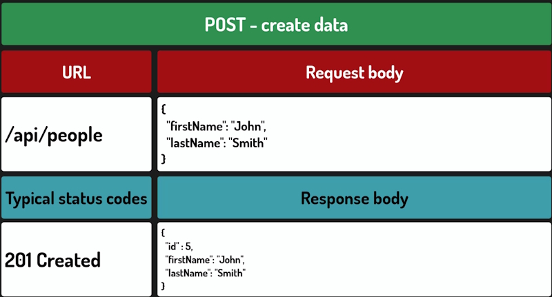

The client sends data in the request body, and the server creates a new record and typically returns it, along with 201 created status code.

**Note:** that the URL for POST is the same as for GETTING all persons.

It is the HTTP method that makes the difference. But when the POST method is used, the client sends the person data, the server creates the record, and returns it with newly assigned ID.

### PUT

**PUT** is used to replace a resource.

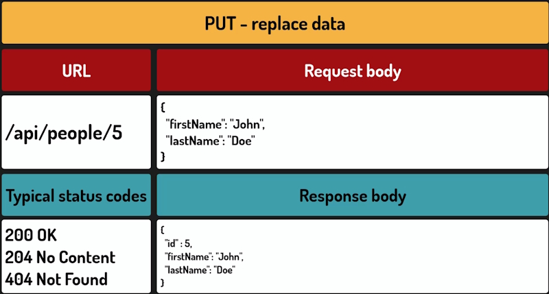

The client sends a complete representation of the resource, and the server replaces the existing record with what was sent.

So for example, for this request, the client sends the full person data, and the server replaces everything it currently has for the person with ID 5 with the new data.

> /api/people/5

**Note:** that the ID remains the same.

The word **REPLACE** is important here. With PUT, the expectation is that the client is sending the entire resource.

If a field is missing from the request body, the server should treat that field as intentionally 
absent, not leave the old value in place.

This is the key difference between **PUT** and **PATCH**.

### PATCH

**PATCH** is used for partial updates.

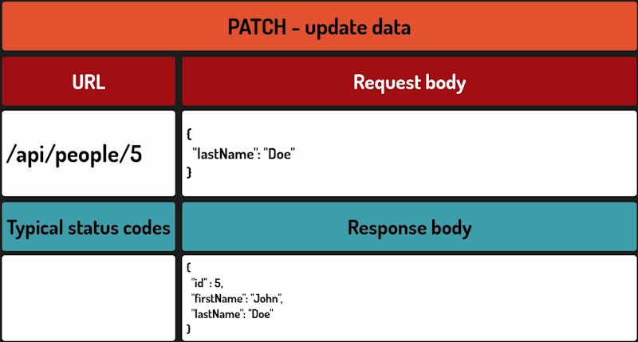

Instead of sending the entire resource, the client sends only the fields that need to change. The server applies those changes and leaves everything else untouched. If we only want to update the email address of a person, we send just the email.

With **PUT**, we would need to send all the person's field. First name, last name, date of birth, and so on just to change one of them.

The general guidance is this.

Use **PUT** when the client naturally has the complete resource. For example, when the user has filled out a full edit form and is sending everything back.

Use *PATCH* when you are updating specific fields. Especially when the resource is large, or when sending the entire thing would be impractical.

In practice, the line between them can be blurry.

And some APIs simply pick one and use it consistently throughout. That is fine. What is not a good idea is mixing them without a clear reason using PUT in one place and **PATCH** in another for the same type of resource.

Because it makes the API harder to understand and predict.

For **PUT** and **PATCH**, there is no single rule for what status code to return.

You can either go with ``200 OK`` with the updated resource in the body, or ``204 NO CONTENT`` with no body at all.

### DELETE

**DELETE** is used to remove a resource.

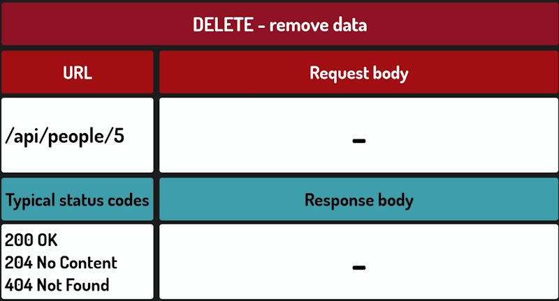

The request typically includes the resource ID in the URL, and the server deletes the corresponding record.

So for example this request would remove the person with ID 5.

> /api/delete/5

A successful **DELETE** usually returns ``204 NO CONTENT``, meaning the operation succeeded and there is nothing to return or sometimes ``200 OK`` with a confirmation message. Both are acceptable.

Similarly as ``FORGET, 404 NOT FOUND`` is also typical, if the resource with the given ID doesn't exist.

## Method safety and Idempotency

Not all HTTP methods behave the same way when something goes wrong. A lost connection, a timeout, a button clicked twice.

HTTP defines two important properties that describe this behavior – **safety** and **idempotency**.

Once you understand them, choosing the right HTTP method becomes much easier.

We will also understand why they matter and how they can help us design our APIs better.

### Safe method

A **safe method** is one that doesn't modify any data on the server. It only reads.

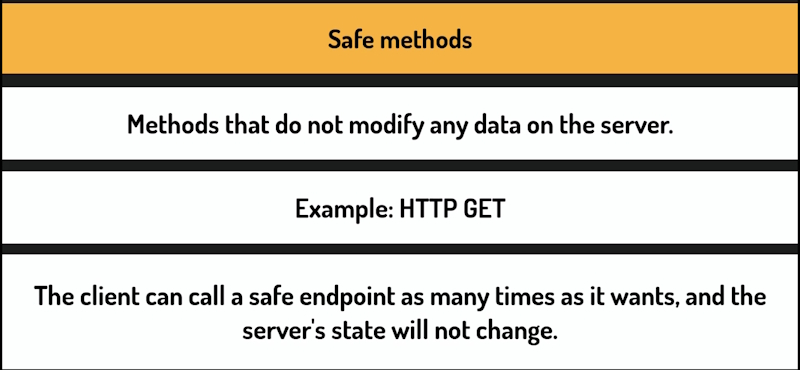

**GET** is the clearest example. The client can call a safe endpoint as many times as it wants. And the server's state will not change.

### Idempotent method 

An **idempotent** method is one where calling it multiple times with the same input produces the same result as calling it once.

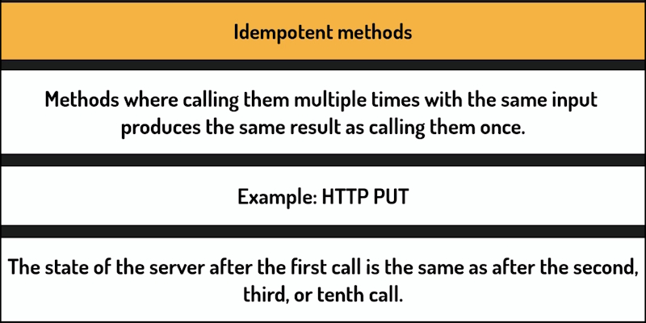

The state of the server after the first call is the same as after the second, third or tenth call. 

**GET** is both safe and idempotent. Reading the same resource repeatedly does not change anything.

**PUT** is idempotent but not safe. If we send PUT with the same data ten times, the record will be in the same state after all ten requests as it was after the first. The operation has an effect – it writes but repeated calls do not cause additional changes.

*DELETE* is also idempotent in principle. After the first call, the resource is gone. Subsequent calls to the same endpoint do not change the outcome. In practice, the server might return a 404 not found on the second call, but the state of the system is the same.

**POST** is neither safe nor idempotent. Each POST request is treated as a new operation. So sending the same request twice typically creates two records.

Alright, but why does this actually matter to us?

#### First property - safety

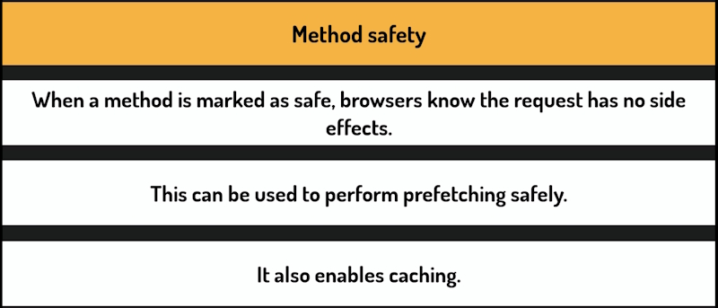

When a method is marked as safe, browsers know the request has no side effects, so they can take shortcuts. 

None of this would be acceptable with **POST**.

#### second property - idempotency

Idempotency matters most when something goes wrong. Imagine a client sends a **DELETE** request and gets no response. Maybe there was a timeout. Maybe the connection dropped. Should it try again?

With an idempotent method, the answer is yes.

Sending the same **DELETE** twice has the same effect as sending it once. The resource is gone either way.

But with **POST**, retrying is risky.

If the first request actually went through, sending it again could create a duplicate.

This is why HTTP clients and libraries use idempotency to decide whether a failed request can be retried. And it is one of the reasons why choosing the right HTTP method matters more than it might seem.

## HTTP Methods - HEAD, OPTIONS and TRACE

These are the lesser-known HTTP methods: HEAD, OPTIONS, TRACE, and CONNECT.

They are not something you will use every day, but you will come across them.

### HEAD

**HEAD** works exactly like **GET**, but the server returns only the response headers without **BODY**. It is useful when a client wants to check whether a resource exists or read its metadata without downloading the full response. For example, some clients use HEAD to check file sizes before downloading.

### OPTIONS

**OPTIONS** returns information about what methods are supported for a given endpoint. In practice, you will see OPTIONS requests quite often. Browsers sometimes send them automatically before their actual requests especially in cross-origin scenarios, also known as **CORS**, to check whether the server allows the request.

So you may see them in your logs and wonder where they come from. They are not something you typically send manually.

### TRACE

**TRACE** is a diagnostic method.

When a client sends a **TRACE** request, the server echoes the request back so the client can see what was received. In practice, you will not use it in REST APIs, and it should be disabled on production servers. Most web frameworks and servers disable it by default,

## HTTP methods best practices

Let's now wrap up what we've learned about HTTP methods and see a couple of best practices for working with them.

**HTTP** methods are not just labels they carry meaning that clients, servers, browsers, and caches all rely on. Using them correctly makes your API predictable and easier to work with.

A practical rule of thumb.

* If the operation retrieves data without side effects, use GET.
* If it creates something new, use POST.
* If it replaces a resource completely, use PUT.
* If it modifies specific fields, use PATCH.
* And if it removes a resource, use DELETE.

## REST API best practices

We are going to look at how the **REST** principles translate into concrete everyday decisions when building an **API**.

### Naming

How we name our endpoint classes and controllers?

If you look at different API projects online, you will notice that people handle this differently. Some developers write BookController, others BooksController. Both are valid and neither will break anything.

What matters is that you pick one convention and stick to it throughout the entire project.

The recommendation is to use the plural form BooksController, AuthorsController, LoansController.

The reason is simple. These classes handle operations on a collection of resources. We are not dealing with a single book. We are dealing with books in general.

### URLs

This is where a lot of inconsistency tends to appear in real APIs.

The core idea is that ``URLs`` should identify resources, not actions.

A resource is a thing, a book, an author, a loan and that's why we use nouns in our URLs, not verbs.

So instead of ``GetBooks`` or ``CreateBook``, we write Books.

The action is expressed by the **HTTP** method.

We also use the plural form for resource URLs. Books not book.

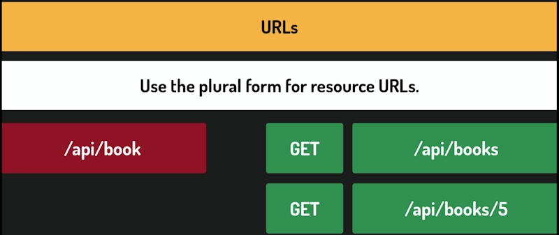

If we want a specific book, we add an identifier, like this.

> /api/books/5 

This pattern is consistent, predictable, and easy to understand.

Anyone working with our API, or even just reading the URL, can immediately understand what they are dealing with.

When a resource belongs to another resource, we reflect that in the URL structure.

The parent resource comes first, and the child resource follows.

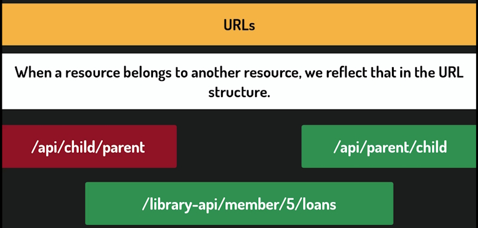

For example, to get all loans for a specific member, we write something like this:

> /library-api/member/5/loans

Because a loan belongs to a member, not the other way around. A library member can exist without any loans. But a loan without a library member doesn't make sense.

The ordering makes the relationship clear and keeps our URLs logical.

One more thing worth mentioning keep URLs **lowercase** and use hyphens to separate words if necessary.

### HTTP methods

They have well-defined, widely understood meanings.

**Get** doesn't modify data.

**Put** replaces an entire resource, not just part of it.

*Delete* removes something.

These aren't just suggestions they are contracts that our API makes with anyone who uses it.

Client applications, testing tools, and other developers all rely on these methods behaving as expected.

The framework doesn't enforce these rules that means it's entirely our responsibility.

### Responses

**Responses** are what we send back to the client. A response should always be complete and informative. That means using the correct HTTP status code and including a body that gives the client enough context to understand what happened.

A bare 400-byte request with an empty body is not helpful. A 400 that also tells the client the field title is required, that's something they can actually act on.

A good error response explains what went wrong from the client's perspective without revealing anything about what's happening on our side.

We should be consistent within a single API and our responses should follow the same patterns.

If we decide that DELETE always returns to a for-no-content, then every DELETE endpoint in our API should behave that way.

If our error responses always include a message field, that field should be there every time.

Inconsistency forces the clients, whether that's a frontend application, a mobile app, or another service, to write special handling for every endpoint. That's frustrating and entirely avoidable.

This might seem like small details, but they add up quickly.

A well-structured API is easier to use, easier to maintain, and easier to extend.

And more often than not, the difference between a confusing API and a clean one comes down to exactly these kinds of decisions.
