# CRUD with Minimal APIs

## GET by ID Route parameter binding

Let's define an endpoint that will return a specific ``Category`` by its ID and  we will understand what **root parameter binding** is.

The endpoint we have so far returns all categories, which is why when using it, we don't pass any additional information.

Let's now add an endpoint that returns a single ``Category``.

To do that, it will need to receive a category ID. Let's add a handler method for that. It will take this ID as a parameter. Let's search for this category in our collection.

```bash
private static async Task<IResult> GetById(int id)
{
    var category = _categories.FirstOrDefault(c => c.Id == id);
    if (category == null)
    {
        return Results.NotFound();
    }
    return Results.Ok(category);
}
```

When writing endpoints, as with all things in programming, we should always think about edge cases. Here, it is possible that a category with a given ID does not exist in our storage.

In that case, we should communicate it with 404 response code, not found.

We can use a helper method from the ``Results`` class to do that.

``Not found`` does not take any arguments, because there is nothing to return to the client.

If the category has been found, we can return a successful result.

Let's not forget to register this endpoint. This is an important part.

```bash
 public static void MapCategoriesEndpoints(this IEndpointRouteBuilder app)
 {
     var group = app
         .MapGroup("/api/categories")
         .WithTags("Categories");

     group.MapGet("/{id}", GetById); // register the endpoint
     group.MapGet("/", GetAll);
}
```

We are telling the framework that ``GetById`` should be called when someone sends a request to ``/api/{id}``.

The curly braces tell the framework that this segment of the URL is a **parameter**, and it should be mapped to the parameter with the same name in the ``GetById`` method.

The name inside the curly braces **must match** the parameter name in the method exactly.

That is how the framework knows which value to map. This mechanism is called **root-parameter binding**.

First send a request for a category that doesn't exist.

> /api/categories/5

We can see that Scalar gives us the ability to set the value of the ID parameter directly. When we do that, it will automatically include it in the path in the correct place.

We get **404 not found** as expected. There is no category with ID 5 in our storage.

Let me now try ID 1, which should return a result. 

> /api/categories/1

This time we get a single object, not a collection. Because this endpoint returns only one category.

## Route constraints

We will now see what root constraints are and how we can use them to control how roots are matched to endpoints.

Let's look at an issue with our present code.

Our endpoint takes a category ID as a parameter. But what happens if we pass something other than an int?

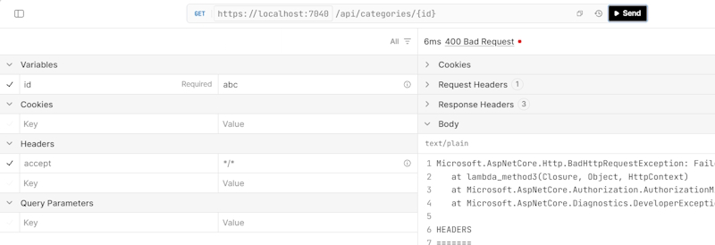

We get a ``400 bad requests``.

Which might even make sense, this request is definitely invalid, since we are passing a ``string`` where an ``int`` is expected.

But what is more concerning is the message we see in the response. *Failed to bind parameter*. This message comes from the parameter binding process.

While it can be useful during development, it is not something we typically want to expose to clients in a production API.

What is also worth noticing is that Scalar hasn't warned us in any way that we are passing 
an invalid value.

We haven't specified this at the routing level, and Scalar cannot see our C# code, where we write that this parameter is an int.

The good news is that we can fix that easily, using a mechanism called **root constraints**.

> group.MapGet("/{id}", GetById);

We can change this to:

> group.MapGet("/{id:int}", GetById); // add the int type

Run this again and the first thing we notice is that Scalar now shows us a warning. We can click on it to see more details. 

Most documentation tools that consume OpenAPI are able to interpret root constraints and show the user information about the expected parameter type.

This time we get ``404 not found``, because we are not able to find an endpoint matching the root we used.

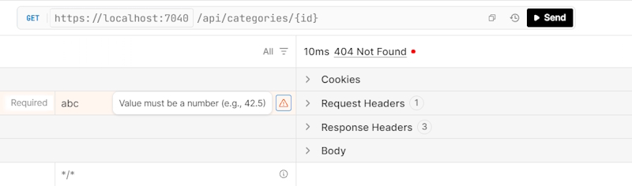

This time we don't see any internal error messages. So this is one benefits of root constraints we get cleaner documentation and more accurate error responses.

To understand the other benefits, we need to look at how root constraints work internally.

Without a root constraint, **all of these requests** will reach the endpoint.

We will encounter a problem only at the moment of parameter binding resulting in a ``400 bad request``.

With root constraint, we clearly state that only routs with an int parameter can be matched to our endpoint.

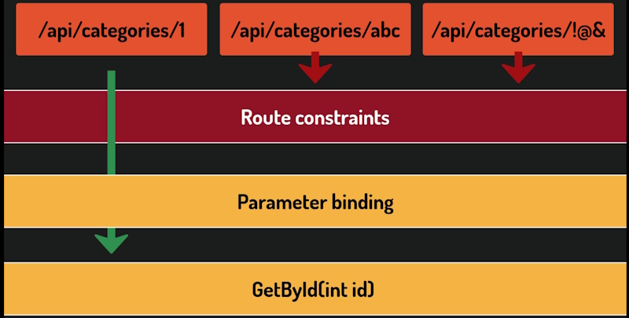

For all other values, the endpoint is never reached, and the parameter binding process never starts.

There is one more benefit worth mentioning. It is possible to have two endpoints that handle what looks like the same root, distinguished only by the parameter type.

For example, imagine that for some reason our categories have not only a regular integer ID, but also a GUID, and we want a separate endpoint for each.

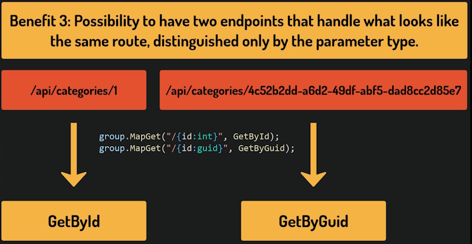

Root constraints make this possible. The correct handler is chosen based on the parameter type.

### List of route constraints

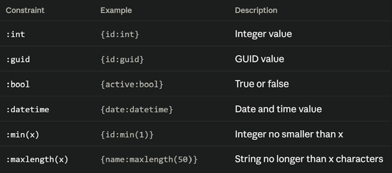

## Documenting response types with Produces

Let's now see how we can improve our API's documentation by adding information about what response types the endpoints can return. We will do that by learning about the **Produces** method.

We will start by identifying the problem.

Here is the documentation of our API in Scalar, specifically the endpoint that returns a category by ID.

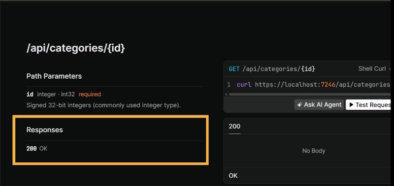

Here we can see the description of what this endpoint may produce.

It says it produces 200 OK. This sounds great, but it is not entirely true. It can also produce a  404 not found, if a category with the given ID does not exist in storage.

Moreover, here it says this endpoint returns a response with no body, which is not true at all. It returns a category if it is found.

It would be nice to include this in the documentation, so it is honest and complete.

One way to do this in minimal APIs is with the **Produces** method.

```bash
    group.MapGet("/{id:int}", GetById)
        .Produces<Category>(200)
        .Produces(404);
```

This method is chained after the Mapping call, and it describes what this endpoint may Produce.

We can call it as many times as we need, specifying all the HTTP status codes that can possibly be returned.

If a response carries a body, like in the case of ``200 OK``, we also specify its type as a type parameter (``Category``).

By the way, using fixed numbers like this is an **anti-pattern** called a magic number.

We are using numeric literals without any description of what they mean. We can fix that by using the built-in StatusCodes class.

```bash
    group.MapGet("/{id:int}", GetById)
        .Produces<Category>(StatusCodes.Status200OK)
        .Produces(StatusCodes.Status404NotFound);
```

One last thing worth mentioning. **Produces** is specific to minimal APIs.

When we use controllers, we will achieve the same result using **attributes** instead. Run the API and check the results.


We can now clearly see that this endpoint may return either 200 OK or 404 not found. We also see the body for both cases.

**Produces** is purely a documentation method. It is useful in its own right, but it lives outside the actual endpoint handler. 

## Type-safe responses in Minimal APIs

Let's now see how we can define our endpoints in a way that they return *strongly typed results*.

We will do that with the help of **TypedResults** class.

Let's start with the endpoint that returns the collection of all ``Categories``.

The only expected response type here is 200 OK because even if we have no categories in storage, we should still return an empty collection which is a perfectly valid result.

Still, even if this response code is shown in Scalar, the response body is not.

We could fix that with produces, but let's approach it differently.

Instead of the very general **IResult**, we want to declare explicitly what this endpoint will produce.

```bash
    private static async Task<Ok<List<Category>>> GetAll()
    {
        var categories = _categories;
        return TypedResults.Ok(categories);
    }
```

This is some serious nesting, so let's understand it step by step.

We return a *Task*, just as before. The result of this **Task** will be of type ``OK``.

A specific type representing an HTTP response with the status ``200 OK``. Inside it, we declare the type of the response payload. In our case, a **List** of Categories.

You might notice that we are using ``List`` rather than a more general type, like ``IEnumerable``.

In regular C# code, returning a more general type is often the better choice. It hides implementation details and gives more flexibility. However, in the context of an API endpoint the **List** type never reaches the client. It gets serialized into JSON before leaving the server.

The client has no idea what type we used internally. That's why we can safely use a ***List*** here.

We also need to change how we produce the result. So far, we have been using the **Results** class.

We will now switch to **TypedResults**, which works in a similar way, but returns specific, strongly typed result objects instead of the general **IResult** interface.

This is how the Scalar documentation looks:

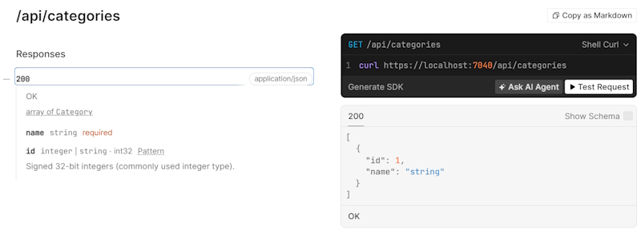

Let's now look at the second endpoint. The one returning a ``Category`` by ID.

Here the situation is a bit more complex, because we have two possible outcomes. Either 200 OK or 404 Not Found.

To reflect that in the return type, we use a special generic type called **Results**, which accepts multiple type parameters.

One for each possible response type the endpoint can return.

```bash
    private static async Task<Results<Ok<Category>, NotFound>> GetById(int id)
    {
        var category = _categories.FirstOrDefault(c => c.Id == id);
        if (category == null)
        {
            return TypedResults.NotFound();
        }
        return TypedResults.Ok(category);
    }
```

Once again, we return a Task. The result of this Task will be of this generic type. A special type that can represent more than one possible HTTP response.

We simply list the possible response types one after another as **type parameters**.

In our case, the response is either 200 OK with a category as the payload, or 404 Not Found with no payload.

Whoever reads this code can see what responses this endpoint can produce.

There is another benefit here. If we try to return a response type that we didn't declare, we will get a compilation error. The code does not compile.

We declared that the 200 OK response carries a Category, but we are trying to return a plain string instead. The compiler caught that mismatch. This is exactly the kind of safety net that **IResult** cannot give us.

Since the method itself now documents what response types it can produce, we could probably get rid of the **Produces** clause. Technically, yes, but we will soon see that **Produces** still has its uses.

Why does the produces method exist at all? Well, there are two common use cases.

The first is when working with code that already uses **IResult** and cannot easily be changed.

In that case, produces is still useful for documenting what an endpoint can return.

The second use case is when, instead of specific response types like NotFound, we decide to return the more general type called **ProblemHttpResult**.

## Model Binding

We need to understand what module binding is.

Let's start by registering a new endpoint.

```bash
    group.MapPost("/", Create);
```

There is no path parameter here. The **Post** endpoint uses the base path for categories, which is ``POST api/categories``.

It is the **HTTP** verb that distinguishes this request from a **GET** to the same address.

Now define the ``Create`` handler method.

```bash
    private static async Task<> Create(Category category)
    {

    }
```

I have left the return type empty for now.

The method takes a ``Category`` object as a parameter. But how does that object get populated with data from the request? This is where **model binding** comes in.

**Model binding** is a mechanism by which ASP.NET Core automatically maps incoming request data to method parameters. It can pull data from different parts of the request. The **root**, the **query stream**, the **headers** or the **body**.

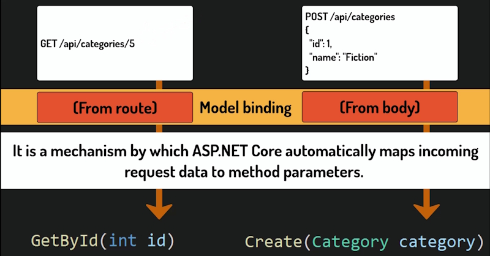

Unlike **GET** requests, **POST** requests carry a **body**, a **payload** with the data we want to  send to the server.

In this case, since our parameter is a complex object, the framework knows to look for it in the body and will automatically deserialize it from JSON into a C# object.

Actually, we have already seen model binding in action, when we extracted the ID from a URL like this.

> GET api/categories/5

That was model binding as well. The framework took that value from the **root** and mapped it directly to the ID parameter in our handler.

For the **POST** request, model binding will take the value from the request **body**.

The other option we have is to get data from a **query**.

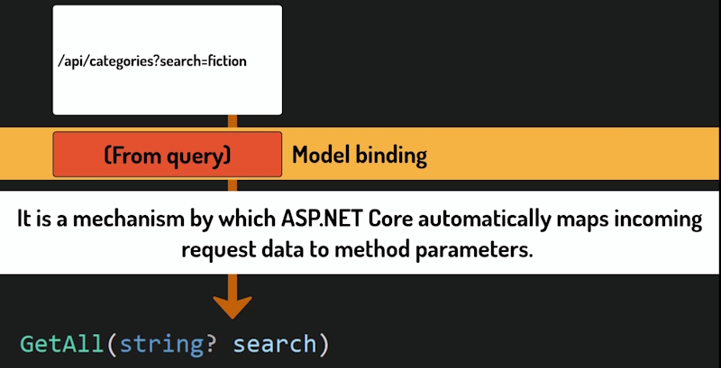

## POST

Let's now implement the **POST** endpoint.

We will also see two new response types in action, **Created** and **Conflict**.

Additionally, we will learn in what order validation checks should be placed in a handler method, and why this order matters.

Let's think about the possible responses. If everything goes well, we should return ``201 Created``. 
This response carries a payload, the newly created object.

But we also need to handle edge cases. In this case, three may occur.

The first is that someone sends us a ``Category`` with an ID that already exists in our storage. 
In that case, the correct response is ``409 Conflict``. The incoming request is conflicting with the current state of our system.

We are currently assuming that the client sends the entire Category object, including the ID. In future the database will automatically generate this for us.

At that point, we can remove this check entirely and update the endpoint so that the client only sends the name.

For now, while we are using an in-memory list, this approach is acceptable.

The second possible problem is that someone sends us a category with a name that is already taken. Category names should be unique. There is no reason to have two Categories called Biography.

This is also a Conflict with the current state of our data so again, ``409 Conflict`` is the right response.

The third possible problem is that someone sends us a ``Category`` with an empty ``Name``. That is not acceptable and we should respond with ``400 Bad Request``.

So we have three possible response types. Let's add them: 

```bash
private static async Task<Results<Created<Category>, Conflict, BadRequest>> Create(Category category)
{

}
```

Next check for existing items in our ``Category`` object.

```bash
private static async Task<Results<Created<Category>, Conflict, BadRequest>> Create(Category )
{
    if (string.IsNullOrEmpty(category.Name))
    {
        return TypedResults.BadRequest();
    }

    if (_categories.Any(existingCategory => existingCategory.Id == category.Id))
    {
        return TypedResults.Conflict();
    }

    if (_categories.Any(existingCategory => existingCategory.Name.Equals(category.Name, mparison.OrdinalIgnoreCase)))
    {
        return TypedResults.Conflict();
    }

}
```

Notice the order of those checks. We start with the lightweight ones. Things we can validate instantly without touching the database. Like checking whether the name is empty.

Only once those pass, we perform the heavier checks that require a database call.

This way, if the input is invalid for a simple reason, we reject it immediately without making an unnecessary trip to the database. It is a good practice and an easy performance gain.

If none of those problems occur, we can safely add the new category to our storage.

```bash
    ...
    _categories.Add(category);
    ...
```

We must also return a **Response**, but this will be a bit more complicated.

## The response from POST

Let's think about what to return in the Success case.

In REST APIs, when a resource is successfully created, we typically respond with two pieces of information.

The **address** at which the new resource can be accessed and the newly **created item** itself.

The address goes into a response header called **Location**. That is the standard place for it. The item itself goes into the **response body**.

Right now this may seem redundant, since the item is exactly what the client sent us. But once we introduce a database, the client will only send a name and we will respond with the complete ``Category`` object, including the generated ID.

We can use the ``TypedResults`` class to build this response.

The first method that may seem adequate is ``Created()``.

The second argument is the newly created item.

The first is the URL when the new resource can be accessed.

Our **GetById** endpoint.

But here is the problem. In REST APIs, we should return a complete, absolute URL, including the base address. That would mean hardcoding the address. This is hard to maintain.

That's why it is better to use the ``CreatedAtRoot()`` method.

```bash
    ...
    _categories.Add(category);
    
    return TypedResults.CreatedAtRoute(category,
        "GetCategoryById",
        new { id = category.Id });
```

The first argument is the newly created object we want to return in the response body.

The second is the name of the root that points to the ``GetById`` endpoint.

The framework will use it to build the full URL automatically, no matter what environment the application is running on.

The third argument provides the root values needed to build that URL. In this case, the ID of the newly created ``Category``.

Since we are using the ``CreatedAtRoot`` method, we must also update the return type.

```bash
private static async Task<Results<CreatedAtRoute<Category>, Conflict, BadRequest>> Create(Category category)
{
    ...
```

We haven't named our root yet, so we still need to do that. Let's now name the root related to the ``GetById`` endpoint.

**WithName** assigns a name to this root, making it possible to reference it from other parts of the application, including ``CreatedAtRoot``, which we just used.

Without this name, the framework would not know which endpoint to use when building the 
URL for the location header.

```bash
    group.MapGet("/{id:int}", GetById)
        .WithName("GetCategoryById");
```

Let's test our post endpoint.

In Scalar we can add our ``Category`` object directly into the request body JSON.

Start with testing for errors.

Add an existing ID and a new Name:

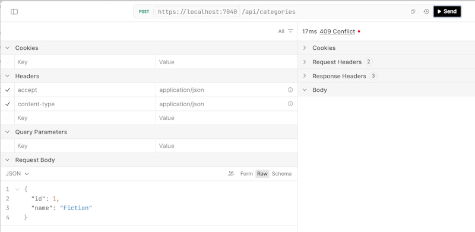

**409 Conflict**, exactly what we expected.

Add a new ID and an existing Name:

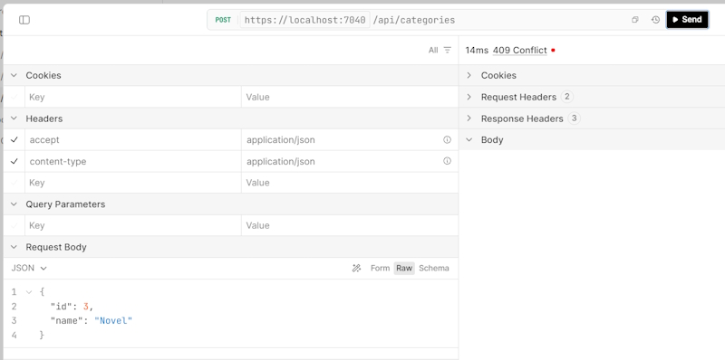

**409 Conflict** again.

Now test with no Name:

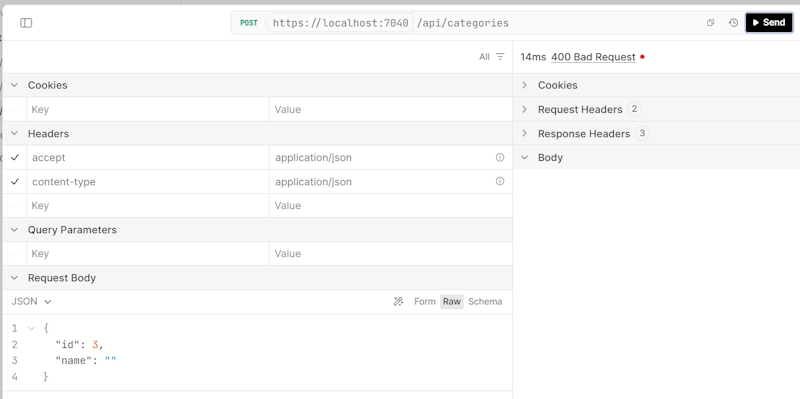

**400 Bad Request** as expected.

Finally, let me send a valid request. 201 Created:

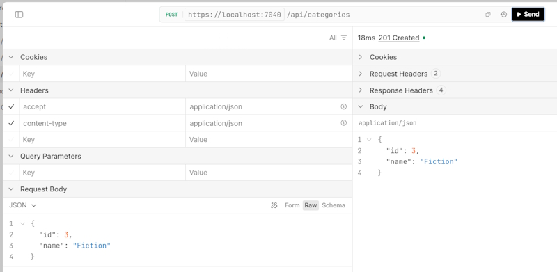

A new category has been created and returned in the response body. Notice that the URL where it can be accessed is not in the body.

It is the part of the response headers:

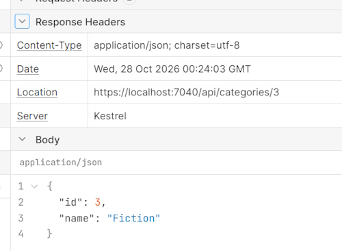

We can use it to make sure the new category has been added. Run the Url in the browser.

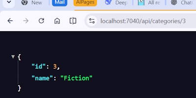

Now, because we are using an in-memory database the extra Category record will only work until we re-compile and then it will disappear. A database will fix this issue.

**Note:** If you run this ``POST`` request with the same data again you will get a **409 Conflict** response.

## Problem Details

Let's now learn about **problem details**, a standardised way to return error responses from an API.

We now have the POST endpoint working, and as we saw, it correctly handles three problematic situations.

We get the right response codes, but there is a problem.

Let's look at the conflicting ID case as an example. As you can see, this response gives the client absolutely no details. Anyone calling this API would have no idea what the conflict is about.

In a real application, the client needs to know what the problem is, to display a meaningful 
message to the user, to understand what went wrong and how to fix it. A status code alone is not enough.

The solution is to use problem details. This is a format for error responses, defined by RFC 9457.

It is not specific to .NET in any way, and ideally, should be followed by any kind of web API.

It defines a JSON structure with several fields.

The most important ones, which you will want to include in almost every error response, 
are status for the HTTP code and detail for a human-readable explanation of what went wrong.

There are also optional fields like type, title, and instance. This standard also requires a specific **content type** header, ``application/problem+JSON``, so that client can recognize the response as a problem details object, rather than just any JSON payload.

The fields we will use are status and detail (we will ignore the others).

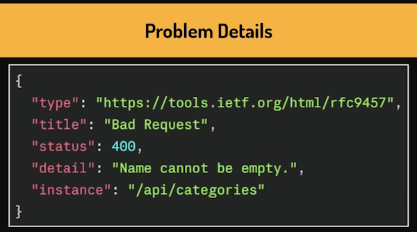

## Updating endpoints to produce Problem Details

Let's now update our endpoints so that they produce problem details.

Previously, we learned about RFC 9457 standard and why it matters, and that it requires error responses to carry a problem details object.

The good news is that .NET supports this out-of-the-box true ``TypedResults`` problem. Let's use it!

```bash
private static async Task<Results<CreatedAtRoute<Category>, ProblemHttpResult>> Create(Category category)
{
    if (string.IsNullOrEmpty(category.Name))
    {
        return TypedResults.Problem(
                detail: "Category name is required.",
                statusCode: StatusCodes.Status400BadRequest);
    }

    if (_categories.Any(existingCategory => existingCategory.Id == category.Id))
    {
        return TypedResults.Problem(
                detail: $"A category with Id {category.Id} already exists.",
                statusCode: StatusCodes.Status409Conflict);
    }

    if (_categories.Any(existingCategory => existingCategory.Name.Equals(category.Name, StringComparison.OrdinalIgnoreCase)))
    {
        return TypedResults.Problem(
                detail: $"A category with the name '{category.Name}' already exists.",
                statusCode: StatusCodes.Status409Conflict);
    }

    _categories.Add(category);

    return TypedResults.CreatedAtRoute(category, "GetCategoryById", new { id = category.Id });
}
```

We changed ``TypedResults.Conflict`` or ``TypedResults.BadRequest`` to ``TypedResultsProblem``. This allows us to add **detail**, an error message and a **statusCode** to provide a more detailed description of what went wrong.

We need to change the return type in the method statement from **Conflict, BadRequest** to **ProblemHttpResult**.

Let's test this in Scalar.

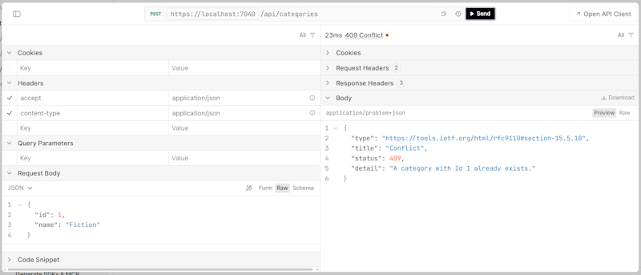

Now we get a more detailed description in the **Response Body**.

Notice the Content Type in the Response Header is now: ``application/problem-json``.

We get this automatically simply because we used ProblemHttpResult as the return type.

There is one problem, however. Let's look at the endpoint documentation.

It no longer declares that it may return **409 Conflict** or **400 Bad Request**.

Luckily, there is a way to bring it back, using the **ProducesProblem** method we saw before.

Here we explicitly declare all possible responses for this endpoint.

```bash
    group.MapPost("/", Create)
        .ProducesProblem(StatusCodes.Status400BadRequest)
        .ProducesProblem(StatusCodes.Status409Conflict);
```

The responses are now documented correctly.

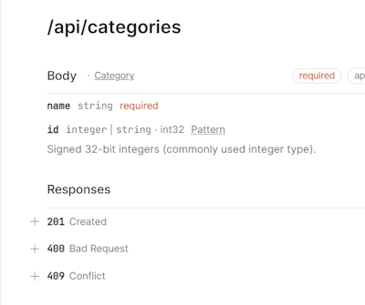

This is a good example of the kind of trade-offs we face every day when building APIs.

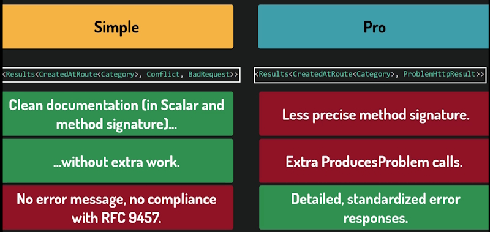

The problem details approach is the more professional and industry-standard choice, and it is what we'll be using going forward.

We also need to update the ``GetById`` method for consistency.

```bash
private static async Task<Results<Ok<Category>, ProblemHttpResult>> GetById(int id)
{
    var category = _categories.FirstOrDefault(c => c.Id == id);
    if (category == null)
    {
        return TypedResults.Problem(
                detail: $"Category with Id {id} not found.",
                statusCode: StatusCodes.Status404NotFound);
    }

    return TypedResults.Ok(category);
}
```

We also need to declare the correct response type.

```bash
    group.MapGet("/{id:int}", GetById)
        .WithName("GetCategoryById")
        .ProducesProblem(StatusCodes.Status404NotFound);
```

## PUT or PATCH

We have to make a decision.

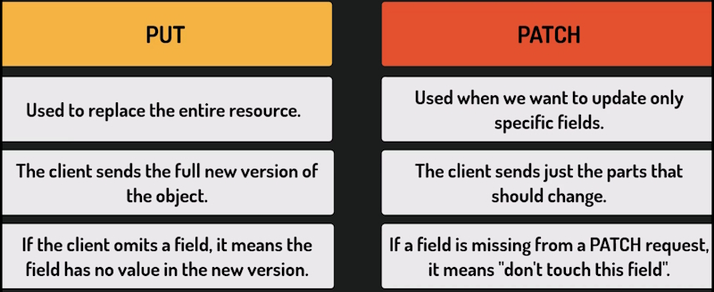

``Category`` only has an ID and Name at the moment so their is no difference. In the future their could be more fields.

We will go with **PUT** for convention. Users who use our API will instinctively reach for **PUT** when they want to modify a resource.

## PUT

Let's now implement the **PUT** operation for categories. Start with the declaration of handler method.

```bash
private static async Task<Results<Ok<Category>, ProblemHttpResult>> Update(int id, Category updatedCategory)
{
    if (string.IsNullOrEmpty(updatedCategory.Name))
    {
        return TypedResults.Problem(
                detail: "Category name is required.",
                statusCode: StatusCodes.Status400BadRequest);
    }

    var existingCategory = _categories.FirstOrDefault(category => category.Id == id);

    if (existingCategory == null)
    {
        return TypedResults.Problem(
                detail: $"Category with Id {id} not found.",
                statusCode: StatusCodes.Status404NotFound);
    }

    if (_categories.Any(category => category.Id != id && category.Name.Equals(updatedCategory.Name, StringComparison.OrdinalIgnoreCase)))
    {
        return TypedResults.Problem(
                detail: $"A category with the name '{updatedCategory.Name}' already exists.",
                statusCode: StatusCodes.Status409Conflict);
    }

    existingCategory.Name = updatedCategory.Name;
    
    return TypedResults.Ok(existingCategory);
}
```

### 2 IDs

This raises an interesting issue though. The ``Category`` object we pass in the body also has an ID. Isn't this redundant? What if the two IDs are different? And shouldn't we just pass the name alone?

These are all valid concerns. And we will deal with them soon, once we start using **DTOs**. **Data Transfer Objects**.

If the two IDs happen to be different, we will simply ignore the one from the body. The ID from the root is the one that wins.

### Updating the Category class

```bash
    existingCategory.Name = updatedCategory.Name;
```

Notice that this one line is enough to update the object stored in the list. ``Categories`` are classes, so they are reference types. Which means existing category and the object inside the list are not two copies. They are the same object.

So when we change the name through the variable, we are changing the object that lives in the list.
 We don't need to update the name. We don't need to tell the list to update anything.

One more thing worth mentioning here.

We are returning **200 OK** with the updated ``Category`` in the body.

There is also another common convention for **PUT**: ``204 No Content``.

Which means, done, nothing to show you. Both are valid. 200 with a body is more convenient when the server might change anything along the way. We will stick with 200 and a body as the safer default.

The last thing we need is to register this endpoint.

```bash
    group.MapPut("/{id:int}", Update)
        .ProducesProblem(StatusCodes.Status400BadRequest)
        .ProducesProblem(StatusCodes.Status404NotFound)
        .ProducesProblem(StatusCodes.Status409Conflict);
```

This is our **PUT** endpoint.

Remember, it takes the ID as the root parameter as well as the updated category in the body. You have to fill in the **ID** value and the **Request JSON**.

Now test this endpoint for errors and a successful update.

## DELETE

We will now implement the delete endpoint for ``Categories``. When using such an endpoint, the user simply passes the ID of the item to be deleted in the request route.

Let's write the signature of the handler that will perform this operation.

```bash
private static async Task<Results<NoContent, ProblemHttpResult>> Delete(int id)
{
    var categoryToBeDeleted = _categories.FirstOrDefault(category => category.Id == id);

    if (categoryToBeDeleted == null)
    {
        return TypedResults.Problem(
                detail: $"Category with Id {id} not found.",
                statusCode: StatusCodes.Status404NotFound);
    }
    _categories.Remove(categoryToBeDeleted);

    return TypedResults.NoContent();
}
```

When a delete operation succeeds, there isn't really anything meaningful we can return.

That's why in REST APIs we typically respond with **204 No Content**.

**200 OK** is also a valid choice, but 204 is by far the most common convention. And that's what we'll use here.

We'll also return program details in case something goes wrong. In this case, the ``Category`` with the given ID may not exist in our storage.

There is one thing worth mentioning here.

In the final version of this application, a ``Category`` would usually have ``Books`` assigned to it.

Deleting a category would then raise an important question. What should happen to those books?

We don't have to worry about this yet because we are still working with a simple in-memory storage and our categories don't yet have any related data.

But it is a problem we'll come back to once we connect a real database. Just bear in mind that those are the things we should always consider when deleting data 
from our system.

For now, the last thing we need to do is to produce the response with status code 204 no content.

```bash
    return TypedResults.NoContent();
```

And let's not forget to register this endpoint. 

```bash
    group.MapDelete("/{id:int}", Delete)
        .ProducesProblem(StatusCodes.Status404NotFound);

```

Test the endpoint to see if it is working correctly.

### Summary

And with that, our endpoint supports all basic CRUD operations.

Create, read, update and delete.

We now have a fully functional set of endpoints that covers everything a client needs to manage.
