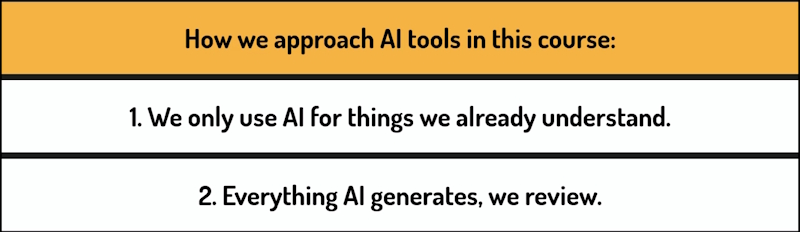
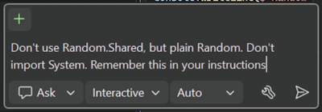
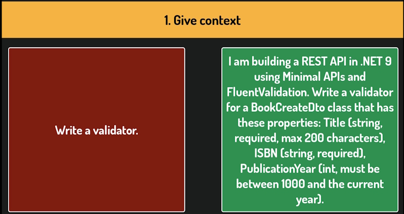
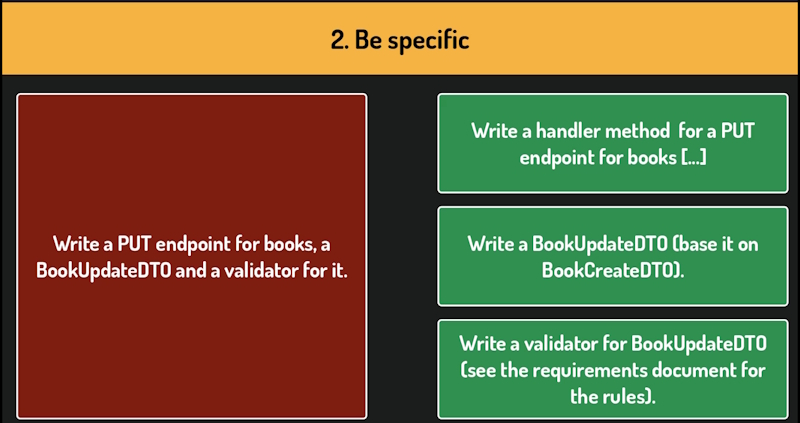
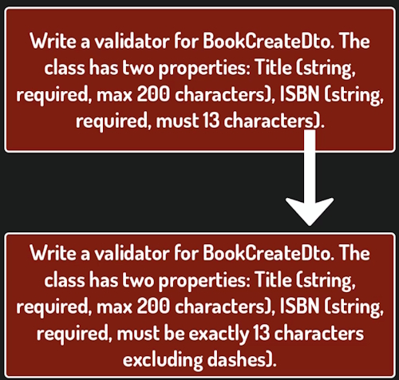

# AI Tools - A practical introduction

## AI Rules



## Creating a simple game

In **Ask** mode:

These are my instructions:

> Guessing game:        
>       
> -- The program randomly picks a number between 1 and 6

Copilot won't add the code it generates automatically. We have the option **Insert at Cursor**. Clicking on this will insert it into your code file.

Generated code:

```bash
using System;

var randomNumber = Random.Shared.Next(1, 7);

Console.WriteLine($"Random number: {randomNumber}");
```

This is pretty basic and has some issues.

## Github Copilot

The code has some statements that aren't required. I will write instructions for Copilot to ignore.

> Don't use Random.Shared, but plain Random             
>       
> Don't import using System



Github Copilot understands that these instructions should be remembered and asks if we want to save them to an instruction file. I saves them to a user file that can be used in all projects.

This file is named ``copilot-instructions.md`` and inside this file, we can write any instructions, coding guidelines, or conventions we want Copilot to follow.

We can edit this file directly or instruct Copilot through the chat and it will update the file for us.

There are many well-tested templates available online. If you search for something like Copilot Instructions for C#, you will find plenty of examples you can copy and use directly.

## Agent mode

Another important mode is **Agent**, which we can select in this drop-down.

Agent mode is more autonomous. You give it a high-level task, and it plans the steps, edits files, runs terminal commands, and keeps going until the task is done.

It does use significantly more of your usage allowance than Ask mode, so it's best saved for larger tasks.

**Agent** mode actually modifies the program file directly, unlike **Ask** mode, which only showed us suggestions.

> Implement a game: the program select the number between 1 and 6.      
>       
> The player has 3 tries to guess it.       
>       
> Print appropriate messages about winning or losing.

Generated code:

```bash
var random = new Random();
var randomNumber = random.Next(1, 7);
const int maxTries = 3;
var won = false;

for (var attempt = 1; attempt <= maxTries; attempt++)
{
    Console.Write($"Try {attempt} of {maxTries} - guess a number between 1 and 6: ");
    var input = Console.ReadLine();

    if (!int.TryParse(input, out var guess) || guess < 1 || guess > 6)
    {
        Console.WriteLine("Please enter a whole number between 1 and 6.");
        attempt--;
        continue;
    }

    if (guess == randomNumber)
    {
        Console.WriteLine("You guessed it! You win!");
        won = true;
        break;
    }

    if (attempt < maxTries)
    {
        Console.WriteLine("That's not it. Try again!");
    }
}

if (!won)
{
    Console.WriteLine($"You ran out of tries. The number was {randomNumber}. You lose!");
}
```

Agents will add the code to the file. You can choose to keep or undo changes. Remember to check all the code that has been generated!

In our code the program closes immediately when a correct guess is added. let's change that.

> Prevent the console from closing immediately after game ends.

Code is generated at the bottom of our original code.

```bash
    ...

    Console.WriteLine("Press any key to exit.");
    Console.ReadKey(intercept: true);
```

This fixes our minor issue.

## Inline chat

We've been using the general chat panel, which is good for broad questions and tasks.

But sometimes we want to focus on a specific piece of code. For that, we use the **inline chat**.

Select the code you want to work with and then either right-click and choose chat or press **Alt+/**.

A small chat window opens directly in the editor, and Copilot's attention is limited to that selection.

I want to change the for loop in the code.

> Refactor this loop to be smaller. Use Helper methods.

Generated code:

```bash
var random = new Random();
var randomNumber = random.Next(1, 7);
const int maxTries = 3;
var won = false;

for (var attempt = 1; attempt <= maxTries; attempt++)
{
    var guess = GetValidGuess(attempt, maxTries);
    if (guess == null) { attempt--; continue; }

    if (guess == randomNumber)
    {
        Console.WriteLine("You guessed it! You win!");
        won = true;
        break;
    }

    if (attempt < maxTries)
        Console.WriteLine("Incorrect guess.");
}

static int? GetValidGuess(int attempt, int maxTries)
{
    Console.Write($"Try {attempt} of {maxTries} - guess a number between 1 and 6: ");
    if (int.TryParse(Console.ReadLine(), out var guess) && guess >= 1 && guess <= 6)
        return guess;
    
    Console.WriteLine("Please enter a whole number between 1 and 6.");
    return null;
}

if (!won)
{
    Console.WriteLine($"You ran out of tries. The number was {randomNumber}. You lose!");
}

Console.WriteLine("Press any key to exit.");
Console.ReadKey(intercept: true);
```

Another useful feature is inline code completions. As we type, Copilot suggests what comes next. We can press tab to accept or just keep typing to ignore it.

You can also write a comment to guide the suggestion.

As soon as I pause, Copilot suggests the next lines. Whether the suggestion makes sense depends on how precisely we described what we want. I could accept it with tab and then remove the comment.

Let's look at two more features.

### Explain

The first is **Explain**.

If we come across code that's hard to follow, the kind we sometimes inherit from others and can't immediately make sense of. In this case, Copilot can walk us through it.

Select the code, right-click and choose ``Copilot Actions -> Explain``.

Copilot will break it down step by step in the chat panel.

### Compilation errors

Finally, Copilot can help **fix compilation errors**.

Intentionally introduce an error. Now, let's ask Copilot to fix them.

Copilot asks whether it can access the build logs and build the solution to verify the fix. Let's allow that.

Now it has the actual compiler output to work with and it correctly identified the issue.

Let's apply the changes.

### An example copilot-instructions.md file

```bash
---
description: Guidelines for building modern C# and .NET applications
applyTo: "**/*.cs"
---

# C# and .NET Development Guidelines

## 1. Language Version & Core Standards
* **Target Version:** Always write idiomatic C# using the latest language features (C# 13/C# 14 capabilities).
* **Architecture:** Prioritize Clean Architecture, Domain-Driven Design (DDD), and SOLID principles.
* **Formatting:** Adhere to `.editorconfig` rules. Use Allman brace style, file-scoped namespaces, and single-line using directives.

## 2. Code Generation & Idiomatic Patterns
* **Nullability:** Strictly enforce Nullable Reference Types (NRT). Validate inputs at entry points using `ArgumentNullException.ThrowIfNull`.
* **Pattern Matching:** Prefer switch expressions and advanced pattern matching over complex `if-else` blocks.
* **Modern Constructs:** Utilize `nameof()` instead of magic strings, collection expressions `[]`, and primary constructors where appropriate.
* **Defensive Coding:** Use `is null` or `is not null` instead of standard equality operators.

## 3. Asynchronous & Performance Best Practices
* **Async/Await:** Always pass a `CancellationToken` through the execution chain. Prefer appending `.ConfigureAwait(false)` in non-UI/library code.
* **Allocation Tuning:** Use `ReadOnlySpan<T>` or `Memory<T>` for heavy data or string parsing to optimize memory allocations.

## 4. Error Handling & Documentation
* **Exceptions:** Catch specific exceptions rather than base `Exception`. Throw meaningful custom exceptions when domain invariants are violated.
* **API Documentation:** Generate proper XML summary comments for public APIs, including `<param>`, `<returns>`, and `<exception>` tags.

## 5. Unit Testing Rules
* **Framework:** Use xUnit/NUnit along with NSubstitute or Moq for mocking.
* **Naming:** Format test methods clearly using `MethodName_StateUnderTest_ExpectedBehavior`.
* **Structure:** Organize tests strictly using the Arrange-Act-Assert (AAA) pattern.
```

## Prompting basics for coding tasks

We are going to look at four practical principles for writing prompts that actually produce good code.

These principles apply the same way regardless of which tool you are using, whether you are 
typing into a chat window in your browser or working with an AI assistant directly in your IDE.

### Give some context

The first principle is to give AI some context.

If you are using AI outside the IDE, it has no idea what project you are working on, what 
technology stack you are using, or what conventions you follow. You need to provide that context yourself.

Even inside the IDE, where the AI can see your project files, it still does not know 
your conventions or architectural decisions unless you spell them out.

Either way, if you do not tell it, it will make assumptions and those assumptions are often wrong.

Compare these two prompts.



Yes, the second prompt takes more effort to write. But because of that effort, we get code that is already 90% of the way there.

Context does not have to be limited to what you type either. Most AI tools let you attach files directly. Relevant source files, a diagram of your architecture, or even a screenshot of an error.

This is often faster and more precise than describing the same thing in words.

Most AI tools also give us a way to store shared context, so we do not have to repeat it in every prompt.

In tools like GitHub Copilot you create an instructions file, and the tool reads it automatically at the start of every session.

Define the context once, and the AI carries it into every conversation.

### Be specific

The second principle is to be specific.

Vague prompts produce vague results.

If you describe exactly what the function should do, what it should receive and what it should return, the result will be much closer to what you need. This also means **don't ask too many things at once**. If you need an endpoint, a DTO and a validator, ask for them one at a time.



### Show a pattern

The third principle is to show a pattern.

This is one of the most effective things you can do.

If you already have a piece of code in your project that does something similar to what you need, show it to the AI and say, do this, but for something else.

The AI will follow your structure, your naming conventions and your coding style. The result will fit naturally into your code base because it is based on something that is already there.

This principle becomes more useful the further you get into a project.

Early on, you are establishing patterns. Later, you are repeating them.

And that repetition is exactly where AI saves the most time.

### Iterate

The fourth principle is to iterate.

Even with a well-written prompt that follows all the principles mentioned, we will not 
always get exactly what we need on the first try. That is not a failure. It is just how it works.



In the example above the first try didn't allow for dashes in the ISBNs. The second iteration gets closer to what we really want.

### Summary

That covers our four principles. Here is a quick reminder before we finish.


These principles work the same way across all AI tools.

## When to be careful with AI

The situations where reaching for AI without thinking can slow you down or cause real problems.

The goal isn't to avoid AI altogether, but to know when to be more careful.

There are three categories worth talking about.

### Things you do not yet understand

First, things you do not yet understand.

If you are learning something new, a concept, a pattern, a technology you have never worked with  before, and you ask AI to write the code for you, you will get something that looks correct.

It may even work, but you will not know why it works. And more importantly, you will not know when it breaks.

### Using AI to make architectural decisions at the start of a project

The second category is using AI to make architectural decisions at the start of a project.

When you are at the beginning of a project, deciding how to structure the codebase, 
what patterns to follow, how different parts will communicate, AI can be a poor decision maker.

The output will tend towards the generic and early architectural decisions are expensive to undo.

This part of the project should be created by somebody who understands the project deeply.

### What not to paste into AI

The third point is about what not to paste into AI.

This is the most practical category, and it catches a lot of people off guard.

Most AI tools send your input to external servers. That means anything you paste into a chat window leaves your machine.

For most code, that is fine. But there are things that should never go in. Passwords, API keys, and tokens are the obvious ones.

A secret in a code file is a risk, no matter what tools you are using. The right place for secrets is outside the code base. 

Database records with real user information, log files, email exports, spreadsheets with customer data. None of this should go into an AI chat.

The rule of thumb is simple. Before you paste something into AI, ask yourself whether you would be  comfortable if that text ended up somewhere outside your organization. If the answer is no, don't paste it.
