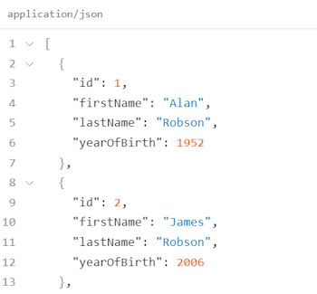
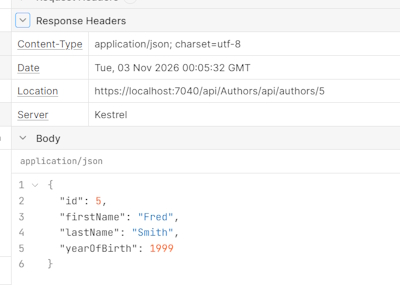
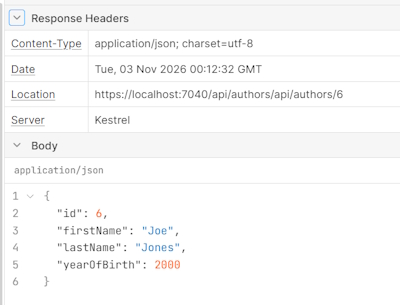
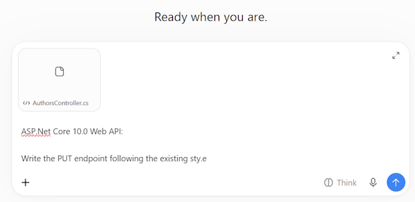

# CRUD with Controllers

We are now going to switch from **Minimal APIs** to **Controller APIs**.

## Author entity

We are going to create the ``Author`` entity. This is a good opportunity to see how we can speed up repetitive work with the help of an AI assistant.

I will open the ``Category`` file as a reference. We could write it manually, but let's ask AI to do it instead.

My prompt:

> I have built a Library Management API.        
>       
> In the Entities folder I have a Categories entity.  Based on this class can you create a Author class with the fields:        
>       
> Id, FirstName, LastName and YearOfBirth.

This is the generated code. I made one change and that is to make ``YearOfBirth`` nullable.

```bash
    public class Author
    {
        public int Id { get; set; }
        public required string FirstName { get; set; }
        public required string LastName { get; set; }
        public int? YearOfBirth { get; set; }
    }
```

Some older authors may have an unknown birth year.

## GET

Create a Controller class and a **GET** endpoint.

Create a folder:

> Controllers

I will add the ``AuthorsController`` class inside it.

Notice that we now have two separate folders. Endpoints for our minimal API style and controllers for the traditional approach.

This is a bit artificial as both folders contain code that defines endpoints for a resource.

But keeping them separate helps us stay organized visually. And it also matches what you will find in most projects so it's a convention worth being familiar with.

Let's start implementing the ``AuthorsController``.

The first thing every controller class needs is to inherit from ``ControllerBase``.

``ControllerBase`` is the base class provided by ASP.NET Core that gives our controller everything it needs to handle **HTTP** requests and produce responses.

It provides helper methods for returning responses, like ``OK``, ``NotFound``, ``BadRequest``, and access

to the HTTP context, which is an object that represents the current request and response. It contains things like request headers or information about the logged in user.

One thing worth mentioning.

There is also a class called ``Controller``, which inherits from ``ControllerBase`` and adds support

for rendering HTML pages. We are building a REST API, so we don't need that.

Next, we want to add the **APIController** attribute to this class. This attribute activates several helpful behaviors.

For example, if a request fails validation, ASP.NET Core will automatically return a `BadRequest`` 
response without us having to check for that manually in every endpoint. It also handles some binding details automatically.

```bash
    [ApiController]
    public class AuthorsController : ControllerBase
    {

    }
```

For now, just think of it as this attribute tells the framework that this class is an **APIController** and it should behave accordingly.

Let's add a temporary local list as our data storage similar to what we did with ``Categories``.

```bash
private static List<Author> _authors = new List<Author>
{
    new Author { Id = 1, FirstName = "Alan", LastName = "Robson", YearOfBirth = 1952 },
    new Author { Id = 2, FirstName = "James", LastName = "Robson", YearOfBirth = 2006 },
    new Author { Id = 3, FirstName = "Charley", LastName = "Robson", YearOfBirth = 2011 }
};
```

Now, let's implement the ``getAll()`` method. Just as with minimal APIs, we make it **async** right away and return a task. It makes no sense now but will when we work with databases.

```bash
    [HttpGet("api/authors")]
    public async Task<ActionResult<List<Author>>> GetAll()
    {
        return Ok(_authors);
    }
```

The return type is ``ActionResult`` of ``List<Author>``.

Instead of ``results.Ok``, we call ``Ok`` directly. It is a method we inherited from ControllerBase.

The ``GetAll()`` method itself is almost ready, but there are a couple of things missing.

First, we need to tell the framework which HTTP method this handler responds to. In minimal APIs, we did that by calling MapGet.

In Controllers, we use an **Attribute**.

Second, the framework still doesn't know which URL root should map to this controller. We define that with the **Route** attribute applied to the class.

```bash
    [ApiController]
    [Route("api/[controller]")]
    public class AuthorsController : ControllerBase
    {
        ...
```

This part is a placeholder. The framework replaces it automatically with the name of our class, minus the word **Controller**. So `AuthorsController`` becomes ``Authors``.

And the full route becomes ``api/Authors``. This is convenient, because we never have to update the root manually if we rename the class.

The last thing we need is to register controllers in ``Program.cs``. This requires two new lines.

```bash
    ...
    builder.Services.AddOpenApi();
    builder.Services.AddControllers();
    ...
```

This registers the **Controller** infrastructure, so that the framework knows Controllers exist in our application and should be used. And secondly:

```bash
        ...
        app.MapCategoriesEndpoints();
        app.MapControllers();
        ...
```

This tells the Routing system to scan our assembly for Controller classes and register 
their endpoints based on the attributes like **Route** and **HTTP** get.

Without this line, our Controller would exist, but never receive any requests.

Let's run and test this application in Scalar.



## Understanding ActionResult\<T>

We need to discuss what **ActionResult** of **T** actually is, why the compiler does not enforce the type we declare inside it, and why we should still always declare it correctly.

Let me show you something that may be a bit surprising. We have:

```bash
Task<ActionResult<List<Author>>> GetAll()
```

Change it to:

```bash
Task<ActionResult<Author>> GetAll()
```

Or:

```bash
> Task<ActionResult<bool>> GetAll()
```

It still compiles? We declare we return an action result with a **boolean**, yet we return a List.

To understand this, we need to look at what ``OK`` actually returns.

``OK`` returns an **OKObjectResult**.

It inherits from **ObjectResult**, which inherits from **ActionResult**.

But the return type is action result of **T**, not **ActionResult**.

So at some point, a conversion must happen from **ActionResult** to **ActionResult** of **T**.

Importantly, this conversion does not check whether the payload matches the declared type **T**.

It behaves the same way, regardless of what the payload actually contains.

So the type parameter **T** is never enforced by the compiler. The framework doesn't verify it at runtime either. So why do we even bother declaring the type here?

Well, there are two reasons.

In Scalar we can see this endpoint documentation, and it shows what the endpoint may return. In this case, a sample value for **bool**.

With the current state of our code, this is completely wrong. The endpoint actually returns a list of authors, which we can confirm by calling it. The endpoint works as expected. A list of ``Authors`` is returned.

It is just the documentation that is lying. And this is a real problem in team environments.

So remember, the type declared inside **ActionResult** of **T** is not enforced by the compiler, but it matters for the people reading our code and for anyone reading the API documentation.

So always make sure it truly reflects what we return from the method.

## GetById

We will implement the ``GetById`` endpoint in our controller.

We will also look at how **root parameters** and **root constraints** work in controllers.

And we will learn how to correctly document all possible responses an endpoint may return.

Let's start with the method signature. It will take an author's ID and return an ``ActionResult`` of ``Author``.

If the author does not exist, we return a **404 Not Found** with a descriptive ``Problem`` details response. The ``Problem`` method comes from ControllerBase.

If the ``Author`` is found, we simply return it with the **200 OK** status.

The body of this method is very similar to what we had in Minimal APIs. It is mostly what surrounds it that differs.

First, we need to declare that this is a ``Get`` method and that it takes an ID parameter in the route.

```bash
[HttpGet("api/authors/{id}")]
```

The string inside the attribute defines the root segment that will be appended to the base root of the controller.

The curly braces mark it as a Route parameter and the name inside, ``id``, must match the name of the method parameter so that the framework knows how to bind them together.

The full root for this endpoint will be ``api/authors/id``.

Just as we did in minimal APIs, we can use a **Route constraint**. This restricts the parameters to integer values only.

```bash
[HttpGet("api/authors/{id:int}")]
```

Lastly, we should declare that this endpoint may return a 404 response.

With controllers, it all lives in one place, right at the method definition as attributes.

```bash
[HttpGet("api/authors/{id}")]
[ProducesResponseType(typeof(ProblemDetails), StatusCodes.Status404NotFound)]
public async Task<ActionResult<Author>> GetById(int id)
{
    var author = _authors.FirstOrDefault(author => author.Id == id);
    if (author == null)
    {
        return Problem(
            detail: $"Author with ID {id} not found.",
            statusCode: StatusCodes.Status404NotFound);
    }
    return Ok(author);
}
```

Let's run the application and check this in Scalar.

I can see an issue already.

The documentation declares that this endpoint may only return 404, while in fact it can also return 200 with a single ``Author`` as the payload.

If we add a **single** ``ProducesResponseType`` attribute, automatic Scalar documentation detection stops.

We have to add the missing attribute.

```bash
[ProducesResponseType(typeof(Author), StatusCodes.Status200OK)]
```

For consistency, add ``ProducesResponseType`` even for an endpoint with only one possible response, like our ``GetAll`` endpoint.

Run the application again and now both responses are documented correctly.

Test for failure (404) and correct (200) responses.

## POST

Let's now implement the **POST** endpoint in our controller. Once again, we'll start with the method signature. We can decorate it with the **HTTP** post attribute right away.

The ``Author`` parameter will be automatically populated with the data from the request body.

It is one of the behaviors that API controller attribute handles for us automatically.

```bash
 [HttpPost("api/authors")]
 public async Task<ActionResult<Author>> Create(Author author)
 {
    ...
```

Now let's deal with validation.

First, let's make sure the Author's first and last name are not empty.

```bash
if (string.IsNullOrWhiteSpace(author.FirstName) || string.IsNullOrWhiteSpace(author.LastName))
{
    return Problem(
        detail: "First name and last name are required.",
        statusCode: StatusCodes.Status400BadRequest);
}
```

Next, we should check whether an Author with the same ID already exists in our storage.

```bash
if (_authors.Any(existingAuthor => existingAuthor.Id == author.Id))
{
    return Problem(
        detail: $"An author with ID {author.Id} already exists.",
        statusCode: StatusCodes.Status409Conflict);
}
```

**Note:** this is only necessary because we are using a local list as a temporary storage. Once we connect to a real database, it will generate unique IDs on its own,

Notice this status code, **409 Conflict**, which is the correct response when a resource with that identifier already exists.

Once again, I perform a cheap check first and only then the one that needs the access to the storage.

Validation for the ``YearOfBirth`` is an option but we will look at this once we get to more advanced validation.

With all those checks passed, we can add the ``Author`` to our storage.

```bash
    _authors.Add(author);
```

Now what should we return as a response?

For post endpoints, we typically return the created object along with the URL at which it can be retrieved, usually a get endpoint with the ID of the new object.

```bash
return CreatedAtAction(nameof(GetById), new { id = author.Id }, author);
```

``CreatedAtAction`` builds the correct response for us.

The first parameter is the name of the method that handles the **GET** request.

And notice we use ``nameof`` rather than a plain string. This is important.

If we ever rename that method, the compiler will catch the problem immediately. With a hard-coded string, it would break silently.

The second parameter is an **anonymous object** containing all the arguments that method needs. In our case, just the ID.

The third parameter is the newly created object.

What is still missing is the documentation of all possible responses.

Let's ask Copilot to add it.

Prompt:

**\Ask**

*Document possible Response Types with ``ProduceResponseType`` attributes for the Create method in the AuthorsController. Base on other methods in the same file.*

This will create the correct response types for us.

```bash
[HttpPost("api/authors")]
[ProducesResponseType(typeof(Author), StatusCodes.Status201Created)]
[ProducesResponseType(typeof(ProblemDetails), StatusCodes.Status400BadRequest)]
[ProducesResponseType(typeof(ProblemDetails), StatusCodes.Status409Conflict)]
...
```

### Complete POST code:

```bash
[HttpPost("api/authors")]
[ProducesResponseType(typeof(Author), StatusCodes.Status201Created)]
[ProducesResponseType(typeof(ProblemDetails), StatusCodes.Status400BadRequest)]
[ProducesResponseType(typeof(ProblemDetails), StatusCodes.Status409Conflict)]
public async Task<ActionResult<Author>> Create(Author author)
{
    if (string.IsNullOrWhiteSpace(author.FirstName) || string.IsNullOrWhiteSpace(author.LastName))
    {
        return Problem(
            detail: "First name and last name are required.",
            statusCode: StatusCodes.Status400BadRequest);
    }

    if (_authors.Any(existingAuthor => existingAuthor.Id == author.Id))
    {
        return Problem(
            detail: $"An author with ID {author.Id} already exists.",
            statusCode: StatusCodes.Status409Conflict);
    }

    _authors.Add(author);

    return CreatedAtAction(nameof(GetById), new { id = author.Id }, author);
}
```

Test this endpoint in Scalar. Check the documentation to see the response types and test all conditions.

Let's check the URL. There is one small issue. The author segment starts with an uppercase letter where URLs in our API should use lowercase letters.



Note: ``Authors`` instead of ``authors``.

Fortunately, ASP.NET Core provides a routing option that takes care of this for us.

In ``Program.cs``:

```bash
    ...
    builder.Services.AddControllers();
    builder.Services.AddRouting(options =>
    {
        options.LowercaseUrls = true;
        options.LowercaseQueryStrings = true;
    });

    var app = builder.Build();
    ...
```

This tells ASP.NET Core to generate all URLs using lowercase letters.

Let's try again.



Now the URL is correct.

Let's use it to confirm the object was actually created.

> https://localhost:7040/api/authors/api/authors/6

This URL returns the object successfully.

## PUT

In this lesson, we will implement the put endpoint in our controller. For a change, let's use ChatGPT AI to write this endpoint. Give it the entire controller class as a context.



Now let's analyze it carefully before we accept anything. That looks correct.

```bash
[HttpPut("api/authors/{id:int}")]
[ProducesResponseType(typeof(Author), StatusCodes.Status200OK)]
[ProducesResponseType(typeof(ProblemDetails), StatusCodes.Status400BadRequest)]
[ProducesResponseType(typeof(ProblemDetails), StatusCodes.Status404NotFound)]
public async Task<ActionResult<Author>> Update(int id, Author author)
{
    var existingAuthor = _authors.FirstOrDefault(a => a.Id == id);

    if (existingAuthor == null)
    {
        return Problem(
            detail: $"Author with ID {id} not found.",
            statusCode: StatusCodes.Status404NotFound);
    }

    if (string.IsNullOrWhiteSpace(author.FirstName) || string.IsNullOrWhiteSpace(author.LastName))
    {
        return Problem(
            detail: "First name and last name are required.",
            statusCode: StatusCodes.Status400BadRequest);
    }

    existingAuthor.FirstName = author.FirstName;
    existingAuthor.LastName = author.LastName;
    existingAuthor.YearOfBirth = author.YearOfBirth;

    return Ok(existingAuthor);
}
```

Add the code and test it in Scalar. The documentation looks correct. The **PUT** endpoint works as expected.

## DELETE

Continue with ChatGPT to create the **DELETE** endpoint.

```bash
[HttpDelete("api/authors/{id:int}")]
[ProducesResponseType(StatusCodes.Status204NoContent)]
[ProducesResponseType(typeof(ProblemDetails), StatusCodes.Status404NotFound)]
public async Task<IActionResult> Delete(int id)
{
    var author = _authors.FirstOrDefault(a => a.Id == id);

    if (author == null)
    {
        return Problem(
            detail: $"Author with ID {id} not found.",
            statusCode: StatusCodes.Status404NotFound);
    }

    _authors.Remove(author);

    return NoContent();
}
```

One small change:

```bash
var authorToBeDeleted = _authors.FirstOrDefault(a => a.Id == id);
```

This makes our intent clear.

Another small change:

```bash
    public async Task<IActionResult> Delete(int id)
    ...
```

Change this to **ActionResult** to match the other endpoints in our controller. **ActionResult** is correct because there is nothing to return in the Body.

**Small recommendation**: As mentioned previously, because your controller has:

> [Route("api/[controller]")]

you can simplify the **DELETE** attribute to **[HttpDelete("{id:int}")]**. This applies to your other endpoint attributes too.

Final code:

```bash
    [HttpDelete("{id:int}")]
    [ProducesResponseType(StatusCodes.Status204NoContent)]
    [ProducesResponseType(typeof(ProblemDetails), StatusCodes.Status404NotFound)]
    public async Task<ActionResult> Delete(int id)
    {
        var authorToBeDeleted = _authors.FirstOrDefault(a => a.Id == id);

        if (authorToBeDeleted == null)
        {
            return Problem(
                detail: $"Author with ID {id} not found.",
                statusCode: StatusCodes.Status404NotFound);
        }

        _authors.Remove(authorToBeDeleted);

        return NoContent();
    }
```
