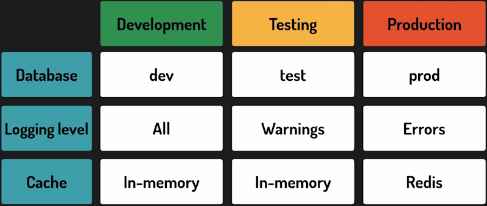
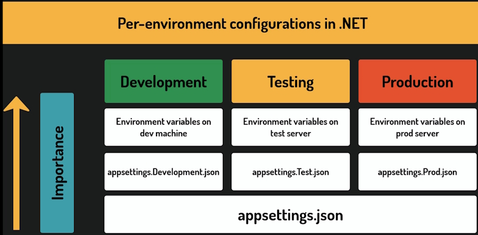
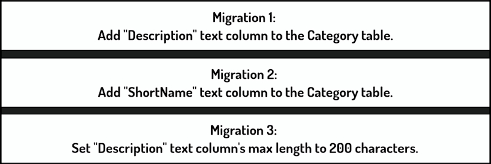
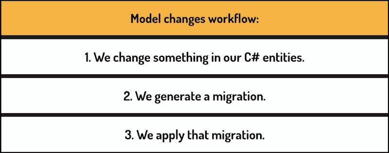
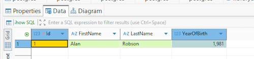

# Database and Entity Framework Core

## Install Entity Framework Core

In Package Manager console install:

> dotnet add package Microsoft.EntityFrameworkCore      
>       
> dotnet add package Npgsql.EntityFrameworkCore.PostgreSQL      
>       
> dotnet add package Microsoft.EntityFrameworkCore.Design       
>       
> dotnet tool install --global dotnet-ef        
>       
> dotnet tool update --global dotnet-ef

### Database provider

> dotnet add package Npgsql.EntityFrameworkCore.PostgreSQL

This is the **PostgreSQL** provider for Entity Framework Core. Entity Framework Core on its own does not know how to talk to any specific database. It needs a provider to do that. Think of it as a translator between Entity Framework Core and PostgreSQL.

This package tells Entity Framework Core how to connect to PostgreSQL, how to generate PostgreSQL-compatible SQL, and how to handle PostgreSQL-specific data types.

If we were using a different database, we would simply install a different provider.

### Entity Framework design tools

> dotnet add package Microsoft.EntityFrameworkCore.Design

This package contains the design tools for Entity Framework Core. Most importantly, the tools we need to create and manage migrations. It is only needed during development, not in production.

### Entity Framework Core command line tool

> dotnet tool install --global dotnet-ef

This installs the Entity Framework Core command-line tool, which we will use to manage migrations. 
For example, to create a new migration, or apply it to the database. 

This is a global tool, meaning it is installed once on our machine and available in any project.

The Entity Framework Core design package we installed earlier works together with this tool. The package provides the code needed to generate migrations, while .NET Entity Framework is the tool that actually runs the commands.

## DbContext

A ``DbContext`` is the central class in Entity Framework Core. It is our main point of contact with the database. It represents an active session with the database, and through it we can query data, save new records, update existing ones and delete them.

Every operation in Entity Framework Core goes through a ``DbContext``.

Let's create one.

Add a new folder in our project and name it **DataAccess**.

Inside, I will create a new class called ``LibraryDbContext``. We typically create one ``DbContext`` per database. Since in our project we will only use one database, this will be our only ``DbContext``.

To make this class a ``DbContext``, we need it to inherit from the ``DbContext`` base class.

We must also provide a constructor that takes one parameter, ``DbContextOptions``.

```bash
    public class LibraryDbContext : DbContext
    {
        public LibraryDbContext(DbContextOptions<LibraryDbContext> options) : base(options)
        {
        
        }
    ...
```

``DbContextOptions`` carries all the configuration our ``DbContext`` needs.

Things like which database provider to use and the connection string. A connection string is simply a piece of text that tells Entity Framework Core where the database is and how to connect to it.

We pass the options to the base class constructor so that Entity Framework Core can read them.

Notice that ``DbContextOptions`` is a generic class. And we pass our own class, ``LibraryDbContext``, as the type parameter.

This is how Entity Framework Core knows which ``DbContext`` this configuration belongs to, which could become important when an application has more than one ``DbContext``.

### DbSet

Now, for each entity that will be mapped to a table in the database, we define a ``DbSet``.

A ``DbSet`` represents a table in the database.

```bash
    public DbSet<Category> Categories => Set<Category>();
    public DbSet<Author> Authors => Set<Author>();
```

It is what we query and operate on. When we want all ``Authors``, we go through this property.

The **Set of T** method on the right side is what actually creates and returns that set.

This returns all Authors. Don't be concerned about returning all this data it is a very lightweight operation.

Entity Framework Core caches these Sets internally, so nothing heavy is happening each time.

You may also come across a different syntax for this in other projects.

```bash
    public DbSet<Category> Categories { set; get;};
    public DbSet<Author> Authors { set; get;};
```

The difference is simple. Our approach with **Set of T** makes the property **read-only**. There is no public setter, so nothing outside of this class can overwrite it. This version exposes a public setter, which is generally unnecessary. Functionally, both approaches work the same way.

### Program.cs

We also need to make some changes in the ``Program.cs`` class.

First, we register the ``DbContext``.

```bash
    builder.Services.AddControllers();
    builder.Services.AddDbContext<LibraryDbContext>(options =>
    {
        options.UseNpgsql(builder.Configuration.GetConnectionString("LibraryDb"));
    });
    ...
```

``AddDbContext`` registers our ``DbContext`` with the application, so that it is available throughout the entire project.

``Options.UseNpgsql`` tells Entity Framework Core to use PostgreSQL as the database, using the provider we installed earlier.

This part retrieves the connection string from the configuration. That is from ``AppSettings.json``.

The key we are looking for is ``LibraryDB``.

Complete ``LibraryDbContext.cs``:

```bash
namespace LibraryManagement.Api.DataAccess
{
    public class LibraryDbContext : DbContext
    {
        public LibraryDbContext(DbContextOptions<LibraryDbContext> options) : base(options)
        {
        
        }

        public DbSet<Category> Categories => Set<Category>();
        public DbSet<Author> Authors => Set<Author>();
    }
}
```

## appsettings.json

Every ASP.NET Core application comes with a configuration file called ``appsettings.json``.

This is where we store settings that our application needs to run. Things like login configuration, feature flags or connection strings. It is a simple JSON file that lives in the root of our project.

If we open it, we can see it already has some content generated automatically when we created the project.

Let's take a quick look at what is in there.

The **logging** section controls how much information the application writes to the log output.

*Allowed hosts* set to asterisk means that the application will accept requests from any host.

Next to ``appsettings.json``, we also have a file called ``appsettings.development.json``.

Let's talk about why that exists. Applications typically run in different environments.

For example, on a developer's machine during development and on a server in production. These environments often need different settings.



A development database is not the same as a production database. Logging might be more detailed locally than on a live server. .NET handles these through environment-specific configuration files.

``Appsettings.json`` contains the base configuration that applies everywhere.

``Appsettings.development.json`` contains settings specific to the development environment. And they override the base file when the application runs locally. The base file is loaded first and the environment-specific file is loaded on top. If the same key appears in both, the **environment-specific** value wins.

So how does .NET know which environment is it running in? Well, it reads an environment variable called ASP.NET CoreEnvironment.

When we run the application from Visual Studio or the .NET CLI locally, this is automatically set to development. Which is why ``appsettings.development.json`` gets picked up.



On a production server, this would typically be set to production.

**Environment variables** are another layer on top of this configuration system. They are key-value pairs set at the operating system level, outside our application.

They sit at the top of the configuration hierarchy, meaning they override everything. Both ``appsettings.development.json`` and the environment-specific file. This is how production secrets are typically handled in professional setups.

Sensitive values, like connection strings or API keys, never live in a file. They are injected as environment variables by the hosting platform.

## Connection strings

A connection string is a piece of text that tells our application where the database is and how to connect to it. It contains things like the host address, the port, the database name and the credentials. 

Where should the connection string go?

We could put it in ``appsettings.json``, but that file is meant to contain **base configuration** that applies to all environments. Settings that are safe and universal.

A connection string is neither of those things. It is local, it is environment-specific and it contains credentials.

**Appsettings.development.json** is the better place. It clearly communicates that this setting belongs to the development environment only.

In production, the connection string would never come from a file. It would be injected as an environment variable by the hosting platform.

Keeping the connection string in the development file from the start builds the right habit.

Environment-specific secrets belong in environment-specific configuration.

### Adding a connection string section

```bash
{
  "Logging": {
    "LogLevel": {
      "Default": "Information",
      "Microsoft.AspNetCore": "Warning"
    }
  },
  "ConnectionStrings": {
    "LibraryDb": "Host=localhost;Port=15432;Database=librarydb;User Id=postgres;Password=london@1;"
  }
}
```

**Host** = localhost means the database is running on our own machine.

**Port** is the default PostgresQL port. The same one we mapped when we set up the Docker container.

The key **LibraryDb** here matches exactly what we used in the ``Program.cs`` file.

Let's make sure now this value can be read. 

Our Docker container:

> docker run --name library-postgres -e POSTGRES_PASSWORD=london@1 -e POSTGRES_DB=librarydb -p 15432:5432 -d postgres

Set a breakpoint on:

> if (app.Environment.IsDevelopment())

Run Debug:

Add a watch value:

> builder.Configuration.GetConnectionString("LibraryDb")

If successful you should be able to view the **connection string**.

With this in place, our application has everything it needs to connect to the database.

## Migrations

Now that our application is connected to the database, we need to actually create the tables. 
This is where **migrations** come in.

A **migration** is the way Entity Framework Core synchronizes our classes with the database.

When we add a new entity, change a property, or add a relationship, the database knows nothing about those changes.

A migration is a file that describes what needs to change in the database to match our C# model and this is important to understand.

Until we generate and apply a migration, the database **will not** change.

If our C# model and the database are out of sync, the application **will not work correctly**.

A good way to think about migrations is a version history of our database.



Each migration is one step in that history. The workflow always follows the same three steps.



1. We change something in our C# entities.
2. We generate a migration and this is when Entity Framework Core compares our current model with the previous state and generates code describing the difference.
3. We apply that migration, which executes that code against the database and updates its schema.

Let's create our first migration. Open the terminal in our project directory and run the following command:

```bash
    dotnet ef migrations add InitialCreate
```

**InitialCreate** is just the name we are giving this migration. It can be anything, but it should describe what the migration does. 

Entity Framework Core will use it as part of the file name.

This command looks at our C# model and compares it with the previous state, which in this case is empty since this is our first migration.

But how does Entity Framework Core know which classes belong to our model?

Well, it knows the heart of our data definition is the ``DbContext``.

Entity Framework Core looks into it and at the **DbSet** properties defined there. Every entity exposed as a **DbSet** is included in the model and Entity Framework will generate the corresponding table for it.

A new folder called **Migrations** has been added to our project.

Let's see what's inside:

> 20261105042548_InitialCreate.cs       
>       
> LibraryDbContextModelSnapshot.cs

We have two files, one representing the **migration** itself and the other the **snapshot**.

The **migration** file describes a specific change, what to add and what to remove from the database schema.

Each **migration** is a separate file, and together they form the full history of our database changes.

The **snapshot** file is different. It does not describe a change, but it represents the current full state of our model.

Entity Framework Core uses it when generating the next migration. It compares our current C# classes with the snapshot to figure out what has changed. This **snapshot** is always overwritten. It does not grow with the project, it just always reflects the latest state.

When working on a project that lives in source control, those files should be included in the repository alongside the rest of the code.

This way, anyone who clones the repository gets the full history of database changes and can bring their local database to the correct state by simply applying the migrations.

The snapshot should be included as well, since Entity Framework core needs it to generate future migrations correctly.

Neither file contains **secrets**, so there is no reason to keep them out of the repository.

## Migration files

Migrations contains two files.

### Migration

The ``migration.cs`` file

It contains two methods:

``Up()`` is called when we apply the migration. It describes what changes need to be made in the database.

``Down()`` is the exact reverse. It describes how to undo those changes and it is what Entity Framework Core would run if we ever needed to roll back this migration.

Let's look at the ``Up()`` method.

It contains two ``CreateTable()`` calls. One for ``Authors`` and one for ``Categories``, which are the two entities we have defined so far.

For each table, Entity Framework Core has mapped our C# properties to database columns.

#### Authors CreateTable code

```bash
migrationBuilder.CreateTable(
    name: "Authors",
    columns: table => new
    {
        Id = table.Column<int>(type: "integer", nullable: false)
            .Annotation("Npgsql:ValueGenerationStrategy", NpgsqlValueGenerationStrategy.IdentityByDefaultColumn),
        FirstName = table.Column<string>(type: "text", nullable: false),
        LastName = table.Column<string>(type: "text", nullable: false),
        YearOfBirth = table.Column<int>(type: "integer", nullable: true)
    },
    constraints: table =>
    {
        table.PrimaryKey("PK_Authors", x => x.Id);
    });
```

The ``Id`` column is defined as an integer with an **auto-increment** strategy. This means PostgresQL will automatically generate a new value for this column whenever we insert a row, which is exactly what we want for a **primary key**.

``FirstName``, ``LastName``, are mapped to **text** columns and marked as not nullable because those properties are non-nullable in our C# classes.

``YearOfBirth`` is mapped to an **integer**.

Each table also gets a primary key constraint defined on the **Id** column.

One thing that is clearly seen here is that Entity Framework Core is heavily convention-driven.

Rather than requiring us to configure everything explicitly, it makes sensible assumptions based on naming patterns.

For example, a property named Id is automatically recognized as a primary or foreign key. No extra configuration is needed.

Similarly, if a property is **nullable** in C#, EF Core will reflect that in the database schema by allowing **null** values in the corresponding column. And **non-nullable** properties will generate a not-null constraint.

These conventions cover most common scenarios and keep your code clean, but they can always 
be overridden with explicit configuration when you need more control.

The last thing in this file is the down method that simply drops both tables.

### Snapshot

This snapshot describes the same model, but in a different form.

Instead of instructions for changing the database, it is a full description of what our model looks like right now.

In our case, the difference is not big, because we started with an empty database. But later, with our fifth or sixth migration, the difference will be noticeable.

The migration will still only describe the latest change, while the snapshot will describe the entire current state of the database.

We can see each Entity defined with all its properties, their column types, which ones are required and which column serves as the primary key.

#### Author Entity method

```bash
modelBuilder.Entity("LibraryManagement.Api.Entities.Author", b =>
    {
        b.Property<int>("Id")
            .ValueGeneratedOnAdd()
            .HasColumnType("integer");

        NpgsqlPropertyBuilderExtensions.UseIdentityByDefaultColumn(b.Property<int>("Id"));

        b.Property<string>("FirstName")
            .IsRequired()
            .HasColumnType("text");

        b.Property<string>("LastName")
            .IsRequired()
            .HasColumnType("text");

        b.Property<int?>("YearOfBirth")
            .HasColumnType("integer");

        b.HasKey("Id");

        b.ToTable("Authors");
    });
```

The ``ValueGeneratedOnAddCol`` on the ``Id`` property tells Entity Framework Core that this value is generated by the database on **Insert**.

**Note:** this file is auto-generated and should never be edited by hand.

## Applying a Migration

**Note:** make sure you have the container up and running.

Let's now see how to apply a migration to our database. Once again, we will do it in the terminal.

```bash
    dotnet ef database update
```

When we run this command, Entity Framework Core takes the ``Up()`` method from our migration and translates it into SQL.

In our case, ``CreateTable`` statements that actually create the ``Authors`` and ``Categories`` tables in PostgreSQL.

The command has run, but there seems to be an error. Taking a close look at it, we will see it is nothing to worry about. Entity Framework Core tried to access a table called EF Migrations History, but it was not found, which makes sense since our database is brand new.

In this case, EF Core simply creates this table from scratch. If we scroll down, we will see that the migration was applied successfully.

## Browsing the database in DBeaver

**Note:** in DBeaver I connected to the PostgreSQL database. I should have connected to the ``librarydb`` database. Make sure you connect to the right database.

Unfold the view of our database all the way to the Tables directory And here we can see our ``Authors`` and ``Categories`` tables.

Look at ``Authors``. We can see four columns, as expected. This matches exactly what we defined in our C# classes.

Now this only shows the database schema, but what if we want to see the actual data? Well, we can just right-click on the table and select View Data. Currently, nothing is here.

Generally speaking, we will not modify our data manually from DBeaver. It will be our API that manipulates the data.

Let's see how to manipulate the data.

There are two approaches we can take.

One more visual and one with generated SQL.

In DBeaver right-click the ``Authors`` table and select ``View Data``. This will show you the table grid view with no data.

To add an author We can right-click on a row, select Edit, and here we have a couple of options, like adding or deleting a row. Add an ``Author``.



You will have to add the ``Id`` value.

Save the data by pressing ``Ctrl-S``.

If you know a little SQL and want to see the queries that update the data, you can take the other approach.

Let's right-click on the author's table and select Generate SQL.

There are many templates here, but for now we need Insert.

```bash
INSERT INTO public."Authors"
("Id", "FirstName", "LastName", "YearOfBirth")
VALUES(2, 'Charley', 'Robson', 2011);
```

Let's copy it and open the SQL Editor. We can do it by right-clicking on our database and selecting SQL Editor, New SQL Script.

To refresh this view, we can right-click on the table and select Refresh.

Let's remove those records to leave the database clean. We can right-click on a record, select Edit and Delete Current Row. Don't forget to save. 

For the second author.

```bash
DELETE FROM public."Authors"
WHERE "Id"=2;
```

After refreshing this view, we see that the table is empty once again.

### __EFMigrationsHistory

You may have noticed that there is a third table here, ``__EFMigrationsHistory``. 

Let's see what data is inside. This table is created and managed automatically by Entity Framework Core. It keeps track of which migrations have already been applied to this database.

Every time we run .NET Entity Framework Database Update, Entity Framework Core checks this table first. If a migration is already listed here, it skips it. If it's not, it applies it and adds a record.

This is how Entity Framework Core knows the current state of the database and avoids applying the same migration twice.

## Troubleshooting migrations and database issues

These are a Few straightforward options that should cover most situations you might encounter during development.

The first scenario is when your database gets into a broken state.

This can happen if migrations get out of sync or if you change something manually and you are not sure how to reverse it. The quickest fix is to drop the database entirely and recreate it from scratch.

```bash
    dotnet ef database drop
```

Let's recreate it.

```bash
    dotnet ef database update
```

The first command removed the database completely. The second recreated it by replaying all migrations from the beginning. In a development environment, this is perfectly fine. On a production database, you would never do this.

Dropping a database means losing all data permanently.

The second case is when you want to remove a migration. In most cases, this should not be necessary. Even if you model something incorrectly, the cleaner approach is to fix your entities and create a new migration on top. But if you do need to remove one, here is how it works.

```bash
    dotnet ef migrations remove
```

If the migration has not been applied to the database yet, simply run this command. This removes the most recent migration. If you need to remove more than one, run the command repeatedly until the migration you want to keep is the latest one.

Do not remove migration files manually.

The ``migrations remove`` command also updates the snapshot file and the two always need to be in sync.

Add some random change in entity and then create and apply new migration.

In Categories:

```bash
    public class Category
    {
        public int Id { get; set; }
        public required string Name { get; set; }
        public string Name2 { get; set; }
    }
```

We added a property to the ``Category`` Entity.

Create a new migration.

```bash
    dotnet ef migrations add AddName2ToCategory
```

Now update it.

```bash
    dotnet ef database update
```

So in our case, the migration is applied.

To revert it, we need to revert the database to the last migration we want to keep.

```bash
    dotnet ef database update InitialCreate
```

The database is rolled back. Once it is done, we can remove the migration locally with .NET Entity Framework migrations remove.

```bash
    dotnet ef migrations remove
```

As you can see, the newest migration file is gone.

## Updating CategoriesEndpoints to use the database
