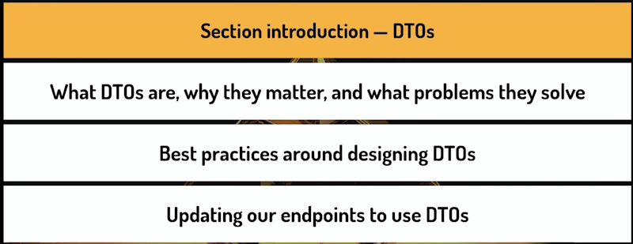
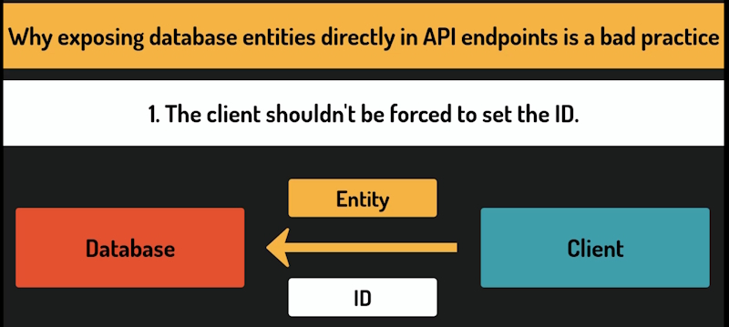
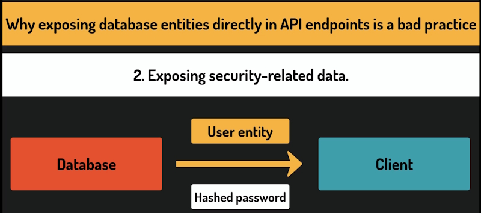
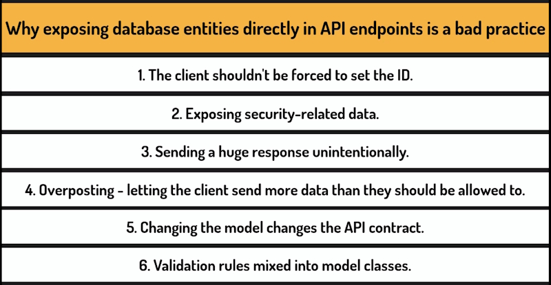
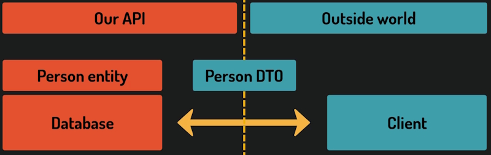
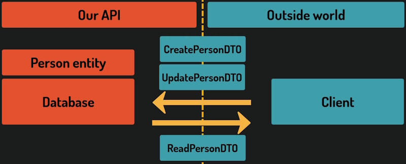
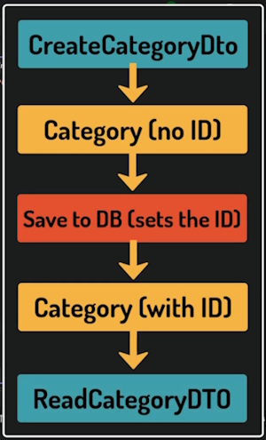
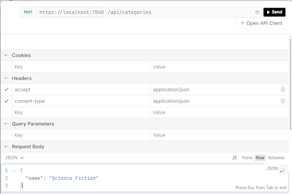

# Data Transfer Objects

In this section, we will learn what *DTOs* are, why they matter, and what problems they solve.

We will also cover the best practices around designing them. By the end, we will have DTOs in place for both ``Categories`` and ``Authors``, and our endpoints updated to use them.



## The need for DTOs

We have an issue in our code and can fix them with DTOs. Look at the handler for the **POST** method for ``Authors``. It takes an entire author object as a parameter and remember, this type has properties ``FirstName``, ``LastName``, ``YearOfBirth`` and, what interests us most right now, ``Id``.

Now, this is a bit problematic. This is a method that creates an Author record. And it is the database that generates ``Id``s for new records.

The client should not be responsible for coming up with an Id, especially since they have no way of knowing which ones are already taken. For now it works, but it is confusing and error-prone.

The OpenAPI documentation still declares that the payload of this request includes an ``Id`` field and if the client actually provides one, the database will accept it.

What we should do instead is pass as a special type that carries all the necessary data, but without the Id field. In our case, that would be just ``FirstName``, ``LastName`` and ``YearOfBirth``.

That special object is called a *DTO*, a Data Transfer Object. And excluding ``Id`` from the request payload is just one of the problems they solve.

## DTOs

There is a lot that is wrong with having our endpoints take or return the exact same types that we save or read from the database. For example, such types often have an ``Id`` And why should the client send it with the **POST** request? It's the database's job to set them.



That is just the tip of the iceberg. Think about an e-commerce API with a user entity. That entity probably has a hashed password as a field. If we return the entity directly from a getEndpoint, that password goes straight to the client. Every field on the entity is exposed automatically, just by being there. We would have to remember to manually exclude sensitive fields every time.



**DTOs** let us deliberately choose what goes into the response for each specific use case. Which means less data fetched from the database, less data serialized, and less data sent over the network.

Risks also appear when we consider the opposite side. Not the responses, but the requests. It can be dangerous when the client sends more data than they should be allowed to, and our API accepts it. This issue is called **overposting** and it can be a huge security risk.



**Note:** Validation involves things like requiring certain fields to be present or limiting string lengths. That validation lives on the DTOs, not on the entities. Our internal objects stay clean and focused on what they were designed for.



An **Entity class** has one job - representing a row in a database. When we use it as the input or output of our endpoints we are asking it to act as a public contract between our API and the outside world. It was never designed for that.

The solution for these issues is to introduce a separate type whose only responsibility is to carry data 
across the **boundary** amd that type is called a **Data Transfer Object**, or a **DTO**. When the client sends a request, they send a DTO — a simple object containing exactly the fields we want to accept. We map that DTO to an entity and save it to the database. 

When we return data, we go the other direction we take the entity, map it to a DTO, and send that to the client.

Notice that the DTO going in and the DTO coming out are typically different types. The **Create DTO** and the **Read DTO**.

The **Create DTO** contains what the client is allowed to send.

The **Read DTO** contains what we've decided to expose.

They are two separate concerns, so we need two separate types.


The mapping steps — converting a DTO to an entity and back — are where you assign fields from one object to the other. It's straightforward, but can get tedious with larger entities. Fortunately, there are libraries that automate this.

In practice, we typically have more than one DTO per entity.



DTOs are simple objects. No logic, no behavior, just properties. Their only job is to carry data, but they give us something truly valuable. A clear, intentional **boundary** between what happens inside our system and what the outside world sees.

## Introducing DTOs for Categories

Create a **DTOs** folder. Inside it, create another folder called **Categories**. As we add more entities, each will get its own subfolder here.

Add a new file called ``CreateCategoryDTO``: 

```bash
    public record CreateCategoryDto
    {
        public required string Name { get; init; }
    }
```

Just one property. No ``Id``. That's the whole point.

Why even introduce a DTO? Why not just accept a plain string in the endpoint? The short answer is, ``Categories`` are simple right now, but they might not stay that way and extending a DTO is trivial. We just add a property.

We are using a ``record`` here rather than a ``class``. Records in C# are designed for types that carry data without behavior, which is exactly what a DTO is. They also give us value equality and immutability out of the box, which are nice properties for objects that cross a boundary and should not be modified after creation.

We will be using the same structure for all our DTOs.

### UpdateCategoryDto

```bash
    public record UpdateCategoryDto
    {
        public required string Name { get; init; }
    }
```

And yes, it looks identical to ``CreateCategoryDTO``. 

### ReadCategoryDto

```bash
    public record ReadCategoryDto
    {
        public int Id { get; init; } 
        public required string Name { get; init; }
    }
```

``ReadCategoryDto`` is what we will return to the client. This one includes an ``Id``, because when we return data, the client needs to know the ``Id``. For example, to construct a follow-up request.

## Updating the Category endpoints to use DTOs

Now we will update our Category endpoints to use the **DTOs** we created.

### GetById

```bash
private static async Task<Results<Ok<ReadCategoryDto>, ProblemHttpResult>> GetById(int id, LibraryDbContext dbContext)
{
    var category = await dbContext.Categories.FindAsync(id);
    if (category == null)
    {
        return TypedResults.Problem(
                detail: $"Category with Id {id} not found.",
                statusCode: StatusCodes.Status404NotFound);
    }

    var readDto = new ReadCategoryDto
    {
        Id = category.Id,
        Name = category.Name
    };

    return TypedResults.Ok(readDto);
}
```

Right now it returns a Category, but we want it to return a ``ReadCategoryDto`` instead.

We will map the ``Category`` **manually**, taking the fields from the entity and putting them in the **DTO**.

This is the mapping step we discussed earlier. Assigning fields from the entity to the DTO. Straightforward, but you can already imagine how this grows with larger entities.

### GetAll

```bash
private static async Task<Ok<List<ReadCategoryDto>>> GetAll(LibraryDbContext dbContext)
{
    var categories = await dbContext.Categories.ToListAsync();

    var readDto = categories.Select(c => new ReadCategoryDto
    {
        Id = c.Id,
        Name = c.Name
    });

    return TypedResults.Ok(readDto.ToList());
}
```

We want to return a list of ``ReadCategoryDto``s instead of a list of ``Categories``.

We use the ``Select`` method from LINQ to map the collection of categories to a collection of ``ReadCategoryDto``s.

We also need to call the ``ToList`` method because `Select` produces an ``IEnumerable`` and we declare that we return a ``List``. 

### Create

```bash
private static async Task<Results<CreatedAtRoute<ReadCategoryDto>, ProblemHttpResult>> Create(CreateCategoryDto createDto, LibraryDbContext dbContext)
{
    if (string.IsNullOrEmpty(createDto.Name))
    {
        return TypedResults.Problem(
                detail: "Category name is required.",
                statusCode: StatusCodes.Status400BadRequest);
    }

    if (await dbContext.Categories.AnyAsync(existingCategory => existingCategory.Name == createDto.Name))
    {
        return TypedResults.Problem(
                detail: $"A category with the name '{createDto.Name}' already exists.",
                statusCode: StatusCodes.Status409Conflict);
    }

    var category = new Category
    {
        Name = createDto.Name
    };

    dbContext.Categories.Add(category);
    await dbContext.SaveChangesAsync();

    var readDto = new ReadCategoryDto
    {
        Id = category.Id,
        Name = category.Name
    };

    return TypedResults.CreatedAtRoute(readDto, "GetCategoryById", new { id = category.Id });
}
```

This one changes on both sides. The input becomes ``CreateCategoryDto`` and the output becomes  ``ReadCategoryDto``.

Here we must create a ``Category`` entity using the ``CreateDto``.

And now the opposite. We create a ``ReadDto`` using the ``Category`` entity.

Notice the flow. 



We receive a ``CreateCategoryDto``, map it to a ``Category``, save the entity, and then map the saved entity to a ``ReadCategoryDto`` and return that. Now it is completely clear that it is the database that sets the ``Id``.

It's not present in the ``CreateDto``. It becomes assigned here once we saved this entity. So this is exactly the pattern we discussed earlier.

``DTOs`` carry data across the boundary between our API and the outside world and each time, they carry only the data that is needed.

### Update

```bash
private static async Task<Results<Ok<ReadCategoryDto>, ProblemHttpResult>> Update(int id, UpdateCategoryDto updateDto, LibraryDbContext dbContext)
{
    if (string.IsNullOrEmpty(updateDto.Name))
    {
        return TypedResults.Problem(
                detail: "Category name is required.",
                statusCode: StatusCodes.Status400BadRequest);
    }

    var existingCategory = await dbContext.Categories.FindAsync(id);

    if (existingCategory == null)
    {
        return TypedResults.Problem(
                detail: $"Category with Id {id} not found.",
                statusCode: StatusCodes.Status404NotFound);
    }

    if (await dbContext.Categories.AnyAsync(category => category.Id != id && category.Name == updateDto.Name))
    {
        return TypedResults.Problem(
                detail: $"A category with the name '{updateDto.Name}' already exists.",
                statusCode: StatusCodes.Status409Conflict);
    }

    existingCategory.Name = updateDto.Name;
    await dbContext.SaveChangesAsync();

    var readDto = new ReadCategoryDto
    {
        Id = existingCategory.Id,
        Name = existingCategory.Name
    };

    return TypedResults.Ok(readDto);
}
```

The input becomes ``UpdateCategoryDto`` and the return type becomes ReadCategoryDto.

### Delete

This one only takes the ``Id`` and doesn't return any data, so no changes are needed here.

### Summary

Every piece of data coming in from the client now arrives as a **DTO**.

Every piece of data going out to the client leaves as a **DTO**.

The entity **never crosses** that boundary it lives entirely inside our system, moving between the endpoint and the database. The endpoint itself is where these two words meet. It receives a DTO, converts it to an entity to work with the database, and when it's done, converts the result back to a DTO before sending it out.

That separation is what gives us control over what the client can send, over what we expose, and over how our internal model can evolve without breaking the contract.

Run the application to make sure everything works as expected.

Look at the **POST** endpoint for ``Categories``.



The request body now shows only ``Name``. No ``Id`` field anywhere and the response shows both ``Id`` and ``Name``, coming from our ``ReadCategoryDto``.

Clean, explicit, and exactly what we designed.

## One DTO per operation

There are two approaches to reducing duplication between DTO classes and there are reasons we are going to avoid both of them.

If you look at our three DTOs, you will notice some significant similarities.

``CreateCategoryDto`` and ``UpdateCategoryDto`` are identical.

Both have just a name property and ``ReadCategoryDto`` is almost the same, just with an extra ``Id`` field.

Let's look at the two ideas that might come to mind.

The first one is this. Why have two separate types for create and update if they look the same? Maybe we can just use one.

A single category input DTO for both post and put endpoints. It would work, but it would create a hidden problem.

``Create`` and ``Update`` operations often start out looking the same, but then they diverge. Maybe at some point we decide that the ``Create`` endpoint should accept a field that only makes sense at creation time, while the ``Update`` endpoint needs something like a last modified reason.

The moment that happens, our shared type starts accumulating properties that only make sense for one of the two operations and the other endpoint is stuck carrying fields it doesn't need and shouldn't expose.

What started as a clean simplification becomes a type that serves two masters and does neither job well.

There is another risk. It becomes easy to forget that the same type is being used in **two different contexts**. A developer modifying it for one operation may not realize they are affecting the other.

There is also a **clarity issue**.

Separate well-named types, ``CreateCategoryDto``, ``UpdateCategoryDto``, make the intent obvious at a glance.

The second approach is related to inheritance.

``ReadCategoryDto`` looks like an extended version of the other two. It has everything they have plus Id.

So why not make CreateCategoryDto and UpdateCategoryDto inherit from some base type and then have ReadCategoryDto extended further?

This looks clean, but it introduces **coupling** between types that should be completely independent.

If we add a property to the base class, all DTOs inherit it, whether they want it or not. So we are back to completely independent, although duplicated types.

Certain projects take different approaches here. Some use the same type for create and update, others use a common base type.

Both can work, but they tend to raise the same discussion and doubts every time requirements evolve.

In many of those projects, the developers eventually split the types into independent ones anyway.

This is the approach most experienced developers consider the safest one.

### Approach to take

We will stick to **duplication** here, with full awareness of what it costs. So our approach will be simple.

* One DTO per operation.
* No shared base classes, no merging.

If two DTOs look the same today, that's fine. If they diverge tomorrow, we will be glad they were always separate.

## Updating the AuthorsController to use DTOs

Let's add DTOs for the ``Authors`` resource and update the ``AuthorsController`` to use them.

We will also practice using GitHub Copilot agent mode.

We need to create three DTO classes and then update the controller to use them instead of the ``Author`` entity directly. And because this is a task we already fully understand, it's a good moment to let Copilot handle it.

What is agent mode?

In a regular Copilot chat, you guide the conversation step by step. You provide context, get a suggestion, apply it, move to the next file. Agent mode works differently.

You give Copilot a high-level task, and it figures out on its own which files to open, what changes to make, and in what order. It can build the solution and react to errors. 

You stay in control. You review and approve everything. But the driving is done by Copilot.

So let's switch the mode from ``Ask`` to ``Agent``.

### Prompt using Agent mode

*Create DTOs for The Author entity following the exact same patterns as the Category DTOs in DTOs/Categories.*

### CreateAuthorDto

```bash
    public record CreateAuthorDto
    {
        public required string FirstName { get; init; }
        public required string LastName { get; init; }
        public int? YearOfBirth { get; init; }
    }
```

### ReadAuthorDto

```bash
    public record ReadAuthorDto
    {
        public int Id { get; init; }
        public required string FirstName { get; init; }
        public required string LastName { get; init; }
        public int? YearOfBirth { get; init; }
    }
```

###

```bash
    public record UpdateAuthorDto
    {
        public required string FirstName { get; init; }
        public required string LastName { get; init; }
        public int? YearOfBirth { get; init; }
    }
```

Before we accept anything, we need to review what it actually did.

Notice an interesting thing about ``UpdateAuthorDto``. All fields except the optional year of birth are required. Just like in ``CreateAuthorDto``. This reflects the semantics of a **PUT** request. The client is not saying change this one field. They are saying replace the resource with what I'm sending. This means all fields must be present every time.

If we wanted to support partial updates, sending only the fields that changed, we would use a different HTTP method called **PATCH**.

Now let's look at completing controller changes.

### Prompt

*Using the DTOs created for the Author entity and following the exact same patterns as the CategoriesEndpoints update the Controllers/AuthorsController to use the DTOs. Please note that we are using a Controller.*

### GetAll

```bash
[HttpGet()]
[ProducesResponseType(typeof(List<ReadAuthorDto>), StatusCodes.Status200OK)]
public async Task<ActionResult<List<ReadAuthorDto>>> GetAll()
{
    var authors = await dbContext.Authors.ToListAsync();
    var readDtos = authors.Select(a => new ReadAuthorDto
    {
        Id = a.Id,
        FirstName = a.FirstName,
        LastName = a.LastName,
        YearOfBirth = a.YearOfBirth
    });

    return Ok(readDtos.ToList());
}
```

### GetById

```bash
[HttpGet("{id:int}")]
[ProducesResponseType(typeof(ReadAuthorDto), StatusCodes.Status200OK)]
[ProducesResponseType(typeof(ProblemDetails), StatusCodes.Status404NotFound)]
public async Task<ActionResult<ReadAuthorDto>> GetById(int id)
{
    var author = await dbContext.Authors.FindAsync(id);
    if (author == null)
    {
        return Problem(
            detail: $"Author with ID {id} not found.",
            statusCode: StatusCodes.Status404NotFound);
    }

    var readDto = new ReadAuthorDto
    {
        Id = author.Id,
        FirstName = author.FirstName,
        LastName = author.LastName,
        YearOfBirth = author.YearOfBirth
    };

    return Ok(readDto);
}
```

### Create

```bash
[HttpPost()]
[ProducesResponseType(typeof(ReadAuthorDto), StatusCodes.Status201Created)]
[ProducesResponseType(typeof(ProblemDetails), StatusCodes.Status400BadRequest)]
public async Task<ActionResult<ReadAuthorDto>> Create(CreateAuthorDto createDto)
{
    if (string.IsNullOrWhiteSpace(createDto.FirstName) || string.IsNullOrWhiteSpace(createDto.LastName))
    {
        return Problem(
            detail: "First name and last name are required.",
            statusCode: StatusCodes.Status400BadRequest);
    }

    var author = new Author
    {
        FirstName = createDto.FirstName,
        LastName = createDto.LastName,
        YearOfBirth = createDto.YearOfBirth
    };

    dbContext.Authors.Add(author);
    await dbContext.SaveChangesAsync();

    var readDto = new ReadAuthorDto
    {
        Id = author.Id,
        FirstName = author.FirstName,
        LastName = author.LastName,
        YearOfBirth = author.YearOfBirth
    };

    return CreatedAtAction(nameof(GetById), new { id = author.Id }, readDto);
}
```

### Update

```bash
[HttpPut("{id:int}")]
[ProducesResponseType(typeof(ReadAuthorDto), StatusCodes.Status200OK)]
[ProducesResponseType(typeof(ProblemDetails), StatusCodes.Status400BadRequest)]
[ProducesResponseType(typeof(ProblemDetails), StatusCodes.Status404NotFound)]
public async Task<ActionResult<ReadAuthorDto>> Update(int id, UpdateAuthorDto updateDto)
{
    var existingAuthor = await dbContext.Authors.FindAsync(id);

    if (existingAuthor == null)
    {
        return Problem(
            detail: $"Author with ID {id} not found.",
            statusCode: StatusCodes.Status404NotFound);
    }

    if (string.IsNullOrWhiteSpace(updateDto.FirstName) || string.IsNullOrWhiteSpace(updateDto.LastName))
    {
        return Problem(
            detail: "First name and last name are required.",
            statusCode: StatusCodes.Status400BadRequest);
    }

    existingAuthor.FirstName = updateDto.FirstName;
    existingAuthor.LastName = updateDto.LastName;
    existingAuthor.YearOfBirth = updateDto.YearOfBirth;

    await dbContext.SaveChangesAsync();

    var readDto = new ReadAuthorDto
    {
        Id = existingAuthor.Id,
        FirstName = existingAuthor.FirstName,
        LastName = existingAuthor.LastName,
        YearOfBirth = existingAuthor.YearOfBirth
    };

    return Ok(readDto);
}
```

**Note:** the naming convention for DTO variables is what we established.

Let's verify everything works by testing it in Scalar.
