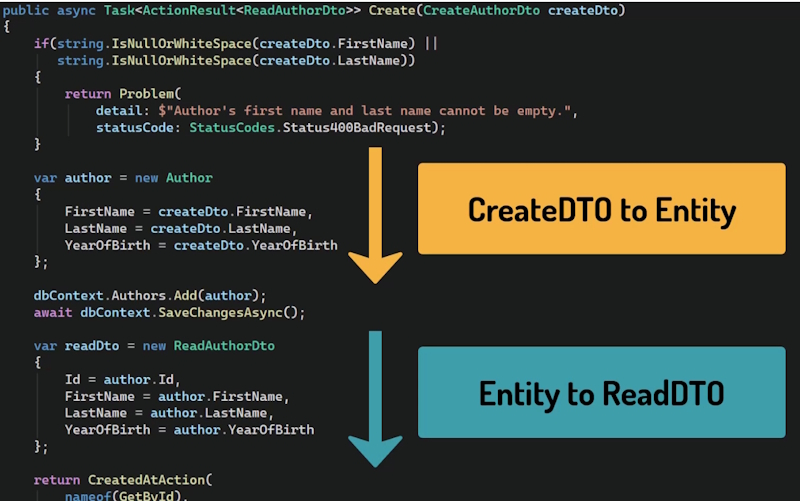
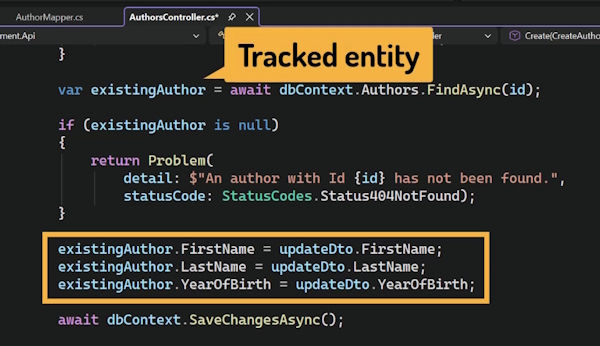
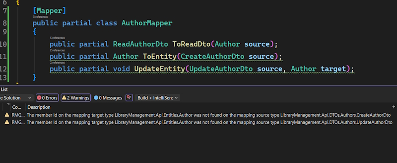
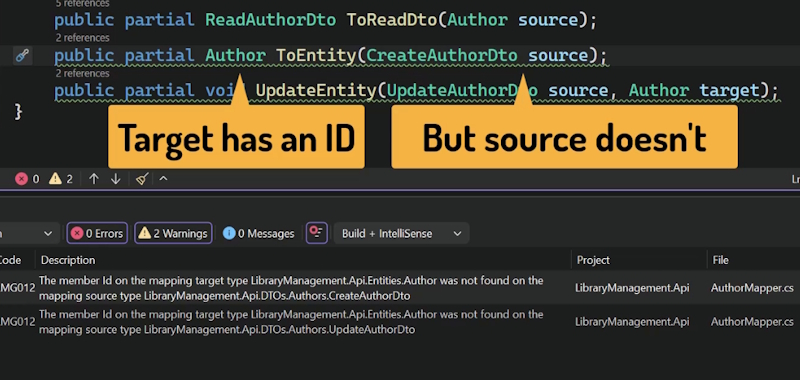
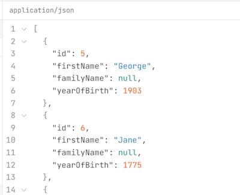
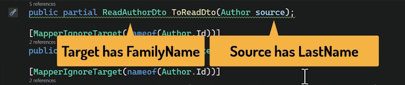
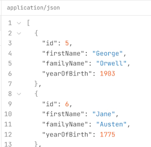
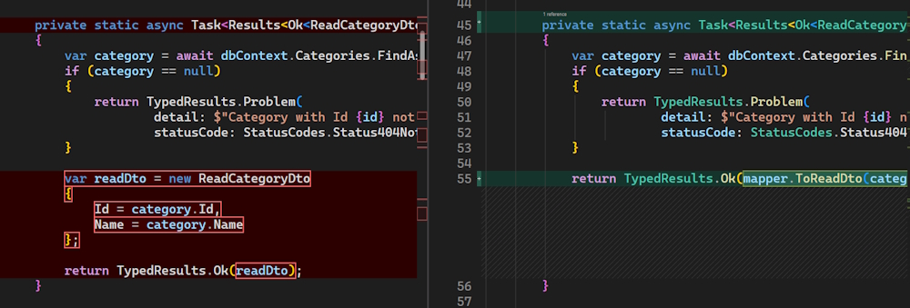

# Mapping

## The problem with Mapping

In our current code we are using manual mapping between entities and DTOs. This doesn't scale well and why we need a better solution.



Our author's controller works. The endpoints return the right data.

But if we look at the code more carefully, there is something worth addressing.

The Create method is a good example. First, we take the incoming ``CreateAuthorDto`` and map it to an ``Author`` entity, copying ``FirstName``, ``LastName`` and ``YearOfBirth`` one by one.

We then save this entity to the database. Then after saving, we go the other direction.

We take the ``Author`` entity that now has a database assigned Id and we manually build a ReadAuthorDto from it to return it in the response. Same properties, copy it again.

So in a single method, we have **two mapping blocks** and this is just for one endpoint.

If we look at GetAll, GetById and Update, we find the same ReadAuthorDto construction repeated in each of them.

That is a lot of repetition for one entity. And as we add more entity types to the project, ``Book``, ``Member``, ``Loan``, each more complex than ``Author``, the amount of manual mapping code will grow quickly And keeping it all consistent will become a real problem. The real risk here is maintenance.

If we add a new property to author, say a ``Biography`` field, we need to remember to update every single mapping block.

What we need is a way to define the mapping between an entity and a DTO once, in one place, so we can then just use it everywhere.

We could write such a mechanism by hand, but that is exactly what mapping libraries are designed to do.

## Introducing Mapperly

For a long time, the most popular mapping library in the .NET ecosystem was **AutoMapper**. It worked well, but some time ago its licensing model changed. As a result, more and more teams have been moving away from it.

**Mapperly** has emerged as a strong alternative.

**AutoMapper** works at runtime. It uses reflection to figure out how to map properties when the application is running.

**Mapperly** takes a different approach. It generates the mapping code at compile time.

This means it is faster, and more importantly, errors show up during compilation rather than at runtime.

### Installing Mapperly

```bash
    dotnet add package Riok.Mapperly
```

Now, let's add a new folder called ``Mapping`` to the project.

Add a new class called ``AuthorMapper``.

To tell ``Mapperly`` that this is a Mapper class, we add the ``Mapper`` attribute.

```bash
using Riok.Mapperly.Abstractions;

namespace LibraryManagement.Api.Mapping
{
    [Mapper]
    public class AuthorMapper
    {
    }
}
```

Now let's declare the first mapping method.

From ``Author`` to ``ReadAuthorDto``.

```bash
    public partial ReadAuthorDto ToReadDto(Author source);
```

This is how Mapperly works. We declare the method signature, the input and the output, and Mapperly generates the implementation for us at compile time.

The partial keyword is what makes this possible. In C#, a partial method is a method split into two parts. One declares the **signature**, and the other provides the **body**.

You could write both parts yourself, but the most typical use case is exactly what we are doing here.

The developer declares the signature, and a tool generates the body.

Partial methods can only exist in partial classes, so classes that are defined in more than one file.

So we need to add the partial modifier to this class as well.

```bash
    [Mapper]
    public partial class AuthorMapper
    {
        public partial ReadAuthorDto ToReadDto(Author source);
    }
```

Right now this doesn't compile. The compiler sees a partial method declaration without a corresponding body. That is expected. The body will be generated by Mapperly, but it needs to build the project first to do so. Let's save and build. And now it compiles.

We can inspect the generated code by holding CTRL and clicking on the method name (or F12).

```bash
// <auto-generated />
#nullable enable
namespace LibraryManagement.Api.Mapping
{
    public partial class AuthorMapper
    {
        [global::System.CodeDom.Compiler.GeneratedCode("Riok.Mapperly", "4.3.1.0")]
        public partial global::LibraryManagement.Api.DTOs.Authors.ReadAuthorDto ToReadDto(global::LibraryManagement.Api.Entities.Author source)
        {
            var target = new global::LibraryManagement.Api.DTOs.Authors.ReadAuthorDto()
            {
                Id = source.Id,
                FirstName = source.FirstName,
                LastName = source.LastName,
                YearOfBirth = source.YearOfBirth,
            };
            return target;
        }
    }
}
```

The generated code maps author to ReadAuthorDto property by property. Exactly the code we have been writing by hand until now. Mapperly simply looks at the property names on both types, and connects them automatically.

Let's add the second mapping.

From ``CreateAuthorDto`` to ``Author``.

```bash
    public partial Author ToEntity(CreateAuthorDto source);
```

Every time we change something in the Mapper classes, we must remember to build the solution.

We will need one more mapping for the ``Update`` case. We'll get to this later.

#### AuthorMapper

```bash
using LibraryManagement.Api.DTOs.Authors;
using LibraryManagement.Api.Entities;
using Riok.Mapperly.Abstractions;

namespace LibraryManagement.Api.Mapping
{
    [Mapper]
    public partial class AuthorMapper
    {
        public partial ReadAuthorDto ToReadDto(Author source);
        public partial Author ToEntity(CreateAuthorDto source);
    }
}
```

## Using the Mapper in AuthorsController

We now want to get Mapperly working to replace all manual mapping code.

First, we need to register the new mapper in ``Program.cs``.

```bash
    builder.Services.AddDbContext<LibraryDbContext>(options =>
    {
        options.UseNpgsql(builder.Configuration.GetConnectionString("LibraryDb"));
    });

    builder.Services.AddScoped<AuthorMapper>();

    builder.Services.AddRouting(options =>
    ...
```

``AddScoped()`` means a new instance of ``AuthorMapper`` is created once per HTTP request and shared within that request. This is the right choice for a mapper.

It has no state on its own, so there is no risk in sharing it, and creating one instance per request is efficient enough for our purposes.

Now let's inject it into the Controller.

```bash
[ApiController]
[Route("api/[controller]")]
public class AuthorsController(LibraryDbContext dbContext, AuthorMapper mapper) : ControllerBase
...
```

We will add it as the primary constructor parameter.

Because we registered ``AuthorMapper`` in **DI container**, ASP.NET Core will automatically provide the right instance whenever ``AuthorsController`` is created.

### GetById

Instead of building the DTO manually, we will now call the mapper. 

```bash
...
    var readDto = mapper.ToReadDto(author);

    return Ok(readDto);
}
```

### GetAll

It follows the same idea, just for the collection of authors. Much cleaner.

```bash
    ...
        var authors = await dbContext.Authors.ToListAsync();
        var readDtos = authors.Select(author => mapper.ToReadDto(author)).ToList();    

        return Ok(readDtos);
    ...
```

We can even make it shorter, like this.

```bash
    var readDtos = authors.Select(mapper.ToReadDto).ToList();
```

Just use the syntax that you find most readable. 

### Create

This is where we have two mapping blocks, and we need to replace both.

First, we map the incoming DTO to an entity.

```bash
    var author = mapper.ToEntity(createDto);
```

Then after saving, we map the entity back to a ReadAuthorDTO for the response.

```bash
    var readDto = mapper.ToReadDto(author);
```

Look how much shorter this method now is.

### Update

Here we run into something slightly different. We are not creating a new ``Author`` object. We are modifying an existing one.

When we fetch an entity from the database, Entity Framework keeps track of it internally.



This means that when we call ``SaveChangesAsync``, Entity Framework Core automatically detects any changes 
made to that object and generates the appropriate **SQL UPDATE** statement.

If we used ``ToEntity`` here, we would get a brand new object that Entity Framework Core knows nothing about and the update would not work correctly.

What we need is a method that takes the existing author object and overwrites its properties with the values from the DTO, in place, without creating a new object.

Let's add that method to AuthorMapper.

```bash
    public partial void UpdateEntity(UpdateAuthorDto source, Author target);
```

Let's build the solution.

Notice two things here. First, this method returns **void**. It doesn't create anything. It just modifies the object we pass in.

Second, Mapper re-figures out the direction of mapping from the method signature.

**Source** is the DTO we are reading from and **target** is the author object we are updating.

We can now use it in the Update method.

```bash
    ...
    mapper.UpdateEntity(updateDto, existingAuthor);

    await dbContext.SaveChangesAsync();

    var readDto = mapper.ToReadDto(existingAuthor);

    return Ok(readDto);
...
```

By the way, whether having a variable like this makes the code more readable is a personal choice. This code would be equally readable if we used it like this.

```bash
    ...
    mapper.UpdateEntity(updateDto, existingAuthor);

    await dbContext.SaveChangesAsync();

    return Ok(mapper.ToReadDto(existingAuthor));
...
```

Do the same for the other methods.

Test your code in Scalar.

## Mapperly - Handling more complex cases

We will look at two situations where the default Mapperly behavior needs a little extra configuration, unmatched properties and different property names.

### Unmatched properties

If we look at the warnings in our project right now, we will see this.



The member ``Id`` on the mapping target type author was not found on the mapping source type ``CreateAuthorDto``. And the same for ``Update``.

This is actually a very valuable warning.

Mapperly is telling us that author has an ``Id`` property, but ``CreateAuthorDto`` does not.



So when building an ``Author`` from the DTO, we can expect to have one property missing.

Such warnings will happen every time we add a new property to an entity, but forget to update the corresponding DTO. In this case, Mapperly will give us a warning.

In this particular case, the warning is expected. Id is generated by the database, so we never include it in the ``CreateAuthorDto``. We just need to tell Mapperly to leave it alone.

We do that with ``MapperIgnoreTarget`` attribute.

``MapperIgnoreTarget`` tells Mapperly not to populate the ``Id`` property on the **target** object.

In our case, the ``Author``. When we set it, Mapperly stops looking for a matching **source** property.

```bash
[Mapper]
public partial class AuthorMapper
{
    public partial ReadAuthorDto ToReadDto(Author source);

    [MapperIgnoreTarget(nameof(Author.Id))]
    public partial Author ToEntity(CreateAuthorDto source);

    [MapperIgnoreTarget(nameof(Author.Id))]
    public partial void UpdateEntity(UpdateAuthorDto source, Author target);
}
```

So the warning is gone.

Id of the ``Author`` stays at its default value of 0. The database will assign the correct value when we save.

We still have the same situation for ``Update``.

So we also need the same attribute at the ``UpdateEntity`` method, since Author is also the **target** there.

There is also a counterpart of this attribute, ``MapperIgnoreSource``, which works in the other direction.

Instead of ignoring a property on the **target**, it tells Mapperly to ignore a property on the **source**, and not map it anywhere.

A typical use case would be an internal field of an DTO, for example, a Client timestamp that we use for logging purposes only. The syntax is identical, just with the **source** property name instead.

### Mismatched property names

Now let's look at the second situation when some configuration may be needed.

Mismatched property names.

Our ``ReadAuthorDto`` currently has a property called ``LastName``, which matches the entity perfectly.

But let's say we decided to rename it to ``FamilyName`` in the **DTO**.

```bash
    public record ReadAuthorDto
    {
        public int Id { get; init; }
        public required string FirstName { get; init; }
        public required string FamilyName { get; init; }
        public int? YearOfBirth { get; init; }
    }
```

Let's try to build. This time the project doesn't compile.

We get an error saying that ``FamilyName`` is **required** on the target, but was not found in the **source**.

That is because ``FamilyName`` is marked as **required** in the DTO.

Let's remove the **required** modifier for now, so we can see what happens without it.

Now it builds, but we get a warning. The target, which is ``ReadAuthorDto``, has a **FamilyName** property, but it wasn't found on the **source**.

Let's see the consequences of that in Scalar.



All those authors have no ``FamilyName``.

This is because Mapperly tried to find such a property on the source, but it couldn't find it, so it simply left it empty on the target.



This is exactly the kind of silent bug that is easy to miss.

We can fix that by telling Mapperly that a property of a given name from the source maps to a property of a different name in the target.

To do that, we can use the MapProperty attribute.

```bash
    [MapProperty(nameof(Author.LastName), nameof(ReadAuthorDto.FamilyName))]
    public partial ReadAuthorDto ToReadDto(Author source);
```

The first argument is the property name on the **source**, ``LastName`` on ``Author``.

The second argument is the property name on the **target**, ``FamilyName`` on ``ReadAuthorDto``.

This explicitly tells Mapperly to take the value from ``LastName`` and put it into ``FamilyName``.

The warnings from Mapperly are gone.Let's make sure the endpoint works as expected.



The family names are now properly set.

This difference in property names was just an example, so let's revert it.

## Using the Mapper for Categories

We will now add a mapper for ``Categories`` and use it in the ``Categories`` endpoint.

Make a copy of ``AuthorsMapper`` and add it to ``CategoriesMapper`` then rename the entities.

Let's build the solution, so Mapperly can generate the implementations.

Now let's update Categories endpoints to use the mapper.

Since we already know what to do, this is a good moment to use AI.

### Prompt

> Update Categories endpoints to use the CategoryMapper for all mapping, instead of manual property assignment. Use AuthorsController as a reference for how the mapper should be used.

Results:

### Program.cs

```bash
    builder.Services.AddScoped<AuthorMapper>();
    builder.Services.AddScoped<CategoryMapper>();
```

### CategoriesEndpoints

```bash
private static async Task<Ok<List<ReadCategoryDto>>> GetAll(LibraryDbContext dbContext, CategoryMapper mapper)
{
    var categories = await dbContext.Categories.ToListAsync();

    return TypedResults.Ok(categories.Select(mapper.ToReadDto).ToList());
}

private static async Task<Results<Ok<ReadCategoryDto>, ProblemHttpResult>> GetById(int id, LibraryDbContext dbContext, CategoryMapper mapper)
{
    var category = await dbContext.Categories.FindAsync(id);
    if (category == null)
    {
        return TypedResults.Problem(
                detail: $"Category with Id {id} not found.",
                statusCode: StatusCodes.Status404NotFound);
    }

    return TypedResults.Ok(mapper.ToReadDto(category));
}

private static async Task<Results<CreatedAtRoute<ReadCategoryDto>, ProblemHttpResult>> Create(CreateCategoryDto createDto, LibraryDbContext dbContext, CategoryMapper mapper)
{
    if (string.IsNullOrEmpty(createDto.Name))
    {
        return TypedResults.Problem(
                detail: "Category name is required.",
                statusCode: StatusCodes.Status400BadRequest);
    }

    if (await dbContext.Categories.AnyAsync(existingCategory => existingCategory.Name == createDto.Name))
    {
        return TypedResults.Problem(
                detail: $"A category with the name '{createDto.Name}' already exists.",
                statusCode: StatusCodes.Status409Conflict);
    }

    var category = mapper.ToEntity(createDto);

    dbContext.Categories.Add(category);
    await dbContext.SaveChangesAsync();

    return TypedResults.CreatedAtRoute(mapper.ToReadDto(category), "GetCategoryById", new { id = category.Id });
}

private static async Task<Results<Ok<ReadCategoryDto>, ProblemHttpResult>> Update(int id, UpdateCategoryDto updateDto, LibraryDbContext dbContext, CategoryMapper mapper)
{
    if (string.IsNullOrEmpty(updateDto.Name))
    {
        return TypedResults.Problem(
                detail: "Category name is required.",
                statusCode: StatusCodes.Status400BadRequest);
    }

    var existingCategory = await dbContext.Categories.FindAsync(id);

    if (existingCategory == null)
    {
        return TypedResults.Problem(
                detail: $"Category with Id {id} not found.",
                statusCode: StatusCodes.Status404NotFound);
    }

    if (await dbContext.Categories.AnyAsync(category => category.Id != id && category.Name == updateDto.Name))
    {
        return TypedResults.Problem(
                detail: $"A category with the name '{updateDto.Name}' already exists.",
                statusCode: StatusCodes.Status409Conflict);
    }

    mapper.UpdateEntity(updateDto, existingCategory);

    await dbContext.SaveChangesAsync();

    return TypedResults.Ok(mapper.ToReadDto(existingCategory));
}
```

The easiest way to review the changes is to use a **Git diff**. Go to the ``Git Changes`` tab.

Right-click on the file and select compare with unmodified.



And here is a side-by-side **diff** of the changes.

The first noticeable difference is that in minimal APIs, the mapper is injected as a **method parameter**, rather than into a **constructor**.

This is typical for minimal APIs.

Test your code in Scalar.
