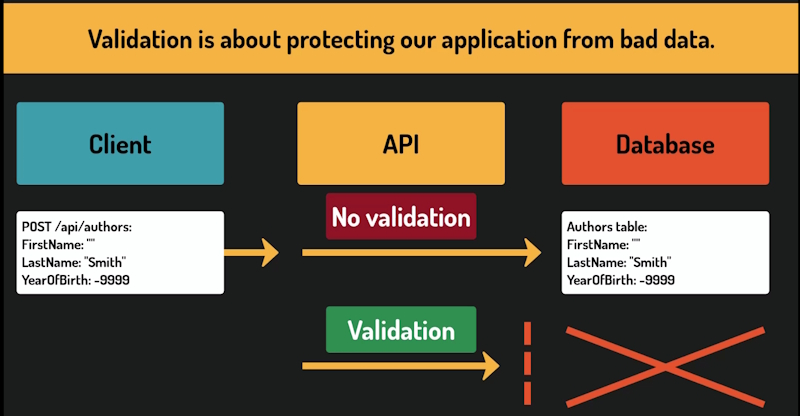
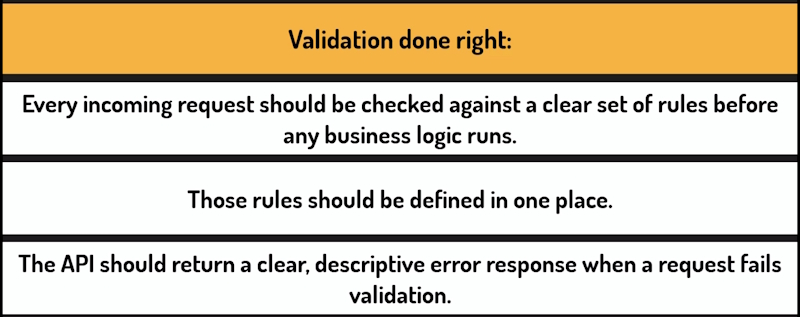
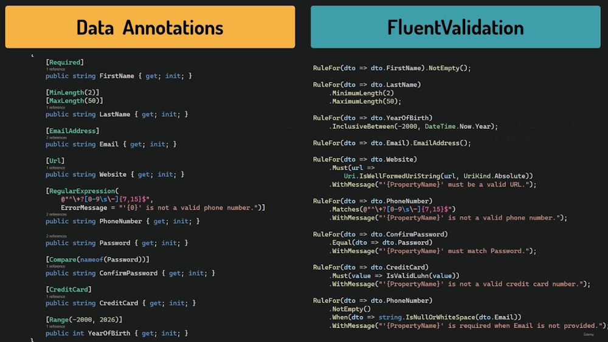
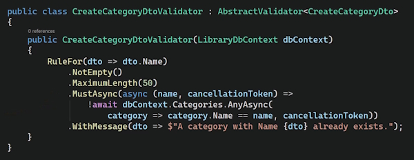
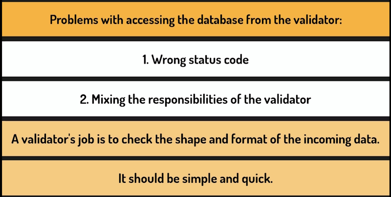

# Validation

Validation is about protecting our application from bad data.



A client sends a request with a missing field, a value in the wrong format, or a number that makes no sense in context. Without validation, that data goes straight into our database, and the problems it causes often only show up much later,

Our controllers already have some basic validation in place.

Let's think about what we are not covering.

For example, let's think about the ``YearOfBirth`` property on the author. Nothing stops a client from sending a value of minus 10,000 or 10,000. That request will pass through our handler and get saved to the database without any complaint.

We could add a check for that, but that is exactly where things start to get messy.

Look at what we already have for ``FirstName`` and ``LastName``. That check appears in the ``Create`` method and then again in the ``Update`` method, written the same way twice.

If we change validation rules we have to change every manual check we have in place.

So what do we actually want from a good validation approach? Well, three things.



## Validation with Data Annotations

We will learn how to validate incoming requests in a controller using data annotations.

When we run a **POST** request with an empty author name We enter the ``Create`` method, even though the **request data** is clearly invalid. This is wasteful. We are running handler code for a request we know is wrong.

Ideally, bad requests should be rejected as early as possible, before any of that happens.

The approach we are going to use for controllers is called **data annotations**.

Attributes from the ``System.ComponentModel.DataAnnotations`` namespace that we place directly on our 
DTO properties to define validation rules.

We're going to add validation attributes to ``CreateAuthorDto`` and ``UpdateAuthorDto`` but not to ``ReadAuthorDto``.

You can notice that our DTO already uses the ``required`` keyword on String properties.

It is worth understanding what that means before we add anything on top of it. In APIs, the required keyword works at the level of JSON deserialization. If a field is missing from the request body, or is explicitly set to null, ``System.Text.JSON`` rejects the request immediately, before we even get to the validation phase.

When we run Scalar and add a blank ``FirstName`` and ``LastName`` they are set to empty strings. This is **not** the same as the null value.

Data annotations include a ``required`` attribute, and it does more than the ``required`` keyword.

Where the keyword only catches a missing or null field, the required attribute also rejects empty strings and whitespace-only strings.

So the required attribute effectively covers the minimum length for us as well.

```bash
    public record CreateAuthorDto
    {
        [Required]
        public required string FirstName { get; init; }
        [Required]
        public required string LastName { get; init; }
        public int? YearOfBirth { get; init; }
    }
```

So which one should we use? The ``required`` keyword or the ``Required`` attribute? Well, we will use both.

The ``required`` keyword stays because it is a good C# practice regardless of HTTP. It ensures that whoever creates this object in code must provide a value.

And the ``Required`` attribute gives us a proper runtime validation with clean descriptive error messages, 
covering null, empty and whitespace strings, all in one attribute.

Let's also add an attribute that limits the length to 50 characters. Now let's think about year of birth. We want to restrict it to a sensible range.

```bash
    public record CreateAuthorDto
    {
        [Required]
        [StringLength(50)]
        public required string FirstName { get; init; }

        [Required]
        [StringLength(50)]
        public required string LastName { get; init; }

        [Range(-2000, 2026, ErrorMessage = "Invalid year of birth")]
        public int? YearOfBirth { get; init; }
    }
```

This is a good moment to notice something. We just added validation to two properties without touching the controller at all.

We define it in the DTO and the controller stays as it is. No digging through handler methods. No risk or forgetting to update one of them.

That is the power of centralized validation. The rules live in one place and everything else just works.

One more thing worth knowing. Our year of birth is a **nullable int**, meaning the field is optional. A client can omit it entirely. Range handles this gracefully.

If the value is null, the attribute does nothing and lets it through.

If a value is provided, it must fall within the specified range.

Picking the right boundaries is an interesting problem. But it is not a programming problem. In a real project, these decisions would come from a business analyst or a product owner. Our job as developers is to implement whatever rules we are given.

Let's do the same changes to ``UpdateAuthorDto``. This, of course, is a duplication. But we discussed it in the section about DTOs. It's a price we pay for having fully independent DTOs.

Now, let's clean up the controller.

We can remove the manual validation checks from ``Create`` and ``Update``.

```bash
[HttpPost()]
[ProducesResponseType(typeof(ReadAuthorDto), StatusCodes.Status201Created)]
[ProducesResponseType(typeof(ProblemDetails), StatusCodes.Status400BadRequest)]
public async Task<ActionResult<ReadAuthorDto>> Create(CreateAuthorDto createDto)
{
    var author = mapper.ToEntity(createDto);

    dbContext.Authors.Add(author);
    await dbContext.SaveChangesAsync();

    return CreatedAtAction(nameof(GetById), new { id = author.Id }, mapper.ToReadDto(author));
}

[HttpPut("{id:int}")]
[ProducesResponseType(typeof(ReadAuthorDto), StatusCodes.Status200OK)]
[ProducesResponseType(typeof(ProblemDetails), StatusCodes.Status400BadRequest)]
[ProducesResponseType(typeof(ProblemDetails), StatusCodes.Status404NotFound)]
public async Task<ActionResult<ReadAuthorDto>> Update(int id, UpdateAuthorDto updateDto)
{
    var existingAuthor = await dbContext.Authors.FindAsync(id);

    if (existingAuthor == null)
    {
        return Problem(
            detail: $"Author with ID {id} not found.",
            statusCode: StatusCodes.Status404NotFound);
    }

    mapper.UpdateEntity(updateDto, existingAuthor);

    await dbContext.SaveChangesAsync();

    return Ok(mapper.ToReadDto(existingAuthor));
}
```

This helps us keep this class focused and following the single responsibility principle. It no longer concerns itself with validation.

You will notice that the ``ProducesResponseType`` attributes are still here. These are unrelated to validation. They are metadata that tells OpenAPI which HTTP status codes this endpoint can return.

So how does the validation actually happen now? We didn't add any validation code to the controller.

The answer lies in the ``ApiController`` attribute at the top of our class. When a request comes in, ASP.NET Core first deserializes the JSON body into our DTO.

If that succeeds, it then checks the resulting object against the validation attributes we defined. If anything fails, automatically returns a 400-bit request response with details about what went wrong and our handler code never runs.

This is part of what is called the **request pipeline**. A sequence of steps every request goes through before it reaches our code.

Test the **POST** handler in Scalar. Try to add a record with null values.

```bash
{
  "type": "https://tools.ietf.org/html/rfc9110#section-15.5.1",
  "title": "One or more validation errors occurred.",
  "status": 400,
  "errors": {
    "LastName": [
      "The LastName field is required."
    ],
    "FirstName": [
      "The FirstName field is required."
    ]
  },
  "traceId": "00-9b44cb7955986e3de3f9c3922929b572-7f27a044ddac4299-00"
}
```

We get this error message and the ``POST`` handler code doesn't run.

## Introduction to Fluent Validation

We already have validation in place for our controllers using Data Annotations. For minimal API endpoints, we could technically use Data Annotations as well.

But without the API controller attribute, there is no automatic mechanism that runs the validation for us. We would have to wire it up manually.

So, for our minimal API's endpoints, we will use **Fluent Validation**.

It is a popular, open-source library for building validation rules in .NET. Instead of placing attributes directly on DTO properties, we define rules in a separate class. One validator class per DTO.

Both approaches to validation, with **Data Annotations** and **Fluent Validation**, are widely used in the .NET world. And neither is wrong.

In practice, most teams pick one approach and stick with it across the entire API for consistency.

**Fluent Validation** gives us more flexibility in how we express validation rules.

For example, with Data Annotations, the range attribute requires compile-time constants. We hard coded the end date.

```bash
    [Range(-2000, 2026, ErrorMessage = "Invalid year of birth")]
```

With **Fluent Validation**, we can write something like this.

```bash
    RuleFor(dto => dto.YearOfBirth)
        .InclusiveBetween(-2000, DateTime.Now.Year)
```

And it just works, because the rules are defined outside the attributes. **Data Annotations** have their own strengths, though.

For simple cases, a single attribute on a property is less code than a separate validator class. They also work out-of-the-box in controllers, without any additional library and because the attributes sit directly on the DTO,

Fluent Validation works with both Minimal APIs and Controllers.

Add the package:

```bash
    dotnet add package FluentValidation
```

## Validation with Fluent Validation

Add a new folder called ``Validators`` to the project.

Add a ``Categories`` folder.

Now, let's create a file called ``CreateCategoryDtoValidator``.

To make this class a Fluent Validation Validator, we must make it inherit from ``AbstractValidator<T>``, where **T** is the type we want to validate.

```bash
using FluentValidation;
using LibraryManagement.Api.DTOs.Categories;

namespace LibraryManagement.Api.Validators.Categories
{
    public class CreateCategoryDtoValidator : AbstractValidator<CreateCategoryDto>
    {
    }
}
```

All the validation rules should be defined in the constructor.

Our ``CreateCategoryDto`` is very simple. So, two rules are all we need.

``UpdateCategoryDto`` is the same.

```bash
    public class CreateCategoryDtoValidator : AbstractValidator<CreateCategoryDto>
    {
        public CreateCategoryDtoValidator()
        {
            RuleFor(dto => dto.Name)
                .NotEmpty()
                .WithMessage("Category name is required.")
                .MaximumLength(50)
                .WithMessage("Category name must not exceed 50 characters.");
        }
    }
```

### UpdateCategoryDtoValidator

```bash
    public class UpdateCategoryDtoValidator : AbstractValidator<UpdateCategoryDto>
    {
        public UpdateCategoryDtoValidator()
        {
            RuleFor(dto => dto.Name)
                .NotEmpty()
                .WithMessage("Category name is required.")
                .MaximumLength(50)
                .WithMessage("Category name must not exceed 50 characters.");
        }
    }
```

Once again, these two validators are identical because our DTOs are identical. Here we are accepting some code repetition in exchange for keeping our types independent.

It often happens that we need slightly different validation rules for creation and update. And then we would be happy we have two separate validators.

Now, let's register our validators in ``Program.cs``.

```bash
builder.Services.AddScoped<AuthorMapper>();
builder.Services.AddScoped<CategoryMapper>();
builder.Services.AddScoped<IValidator<CreateCategoryDto>, CreateCategoryDtoValidator>();
builder.Services.AddScoped<IValidator<UpdateCategoryDto>, UpdateCategoryDtoValidator>();
```

Each line tells the framework. When something asks for ``IValidator<T>``, provide this specific validator class.

Because we just registered the validator in the ``Program.cs``, the framework knows how to provide it automatically. 

Now, let's wire the Validator to the ``Create`` handler.

Let's now call ``ValidateAsync`` and capture the result. ``ValidateAsync`` runs all the rules we defined in our validator against the incoming DTO, and returns a ``ValidationResult`` object. That object tells us whether validation passed, and if not, what exactly failed.

```bash
private static async Task<Results<CreatedAtRoute<ReadCategoryDto>, ProblemHttpResult>> Create(CreateCategoryDto createDto, 
                        LibraryDbContext dbContext, 
                        CategoryMapper mapper,
                        IValidator<CreateCategoryDto> validator)
{
    var validationResult = await validator.ValidateAsync(createDto);
    if (!validationResult.IsValid)
    {
        return TypedResults.Problem( new ValidationProblemDetails(validationResult.ToDictionary())
        {
            Status = StatusCodes.Status400BadRequest
        });
    }
    ...
```

Remove the manual ``IsNullOfWhitespace`` validation check.

Now, let's check the result and return a 400 response if validation failed. ``ToDictionary`` gives us a dictionary where each key is a field name, and each value is an array of error messages for that field. 
We wrap that in ``ValidationProblemDetails``, a built-in class that formats it as a standard ProblemDetails response, and return it with a 400 status.

```bash
{
  "type": "https://tools.ietf.org/html/rfc9110#section-15.5.1",
  "title": "One or more validation errors occurred.",
  "status": 400,
  "errors": {
    "Name": [
      "Category name is required."
    ]
  }
}
```

Do the same for ``Update``. We add the same validation code block for ``Update`` as we did for ``Create``. We need to refactor.

## Validation with Fluent Validation refactoring

To get rid of the duplicated code we will do that with the help of an **Extension method**.

Create a new folder called **Extensions**, and inside it, a new file called ``ValidationExtensions``. 
Let's make this class **static**.

```bash
namespace LibraryManagement.Api.Extensions
{
    public static class ValidationExtensions
    {
        public static ProblemHttpResult ToProblem(this ValidationResult validationResult)
        {
            return TypedResults.Problem(new ValidationProblemDetails(validationResult.ToDictionary())
            {
                Status = StatusCodes.Status400BadRequest
            });
        }
    }
}
```

This doesn't compile because Visual Studio imported the wrong namespace for validation result.

Add these ``using`` statements.

```bash
using FluentValidation.Results;
using Microsoft.AspNetCore.Http.HttpResults;
```

This is how it works. On any validation result, we will be able to call this method as if it was defined on this type. It will then produce a problem HTTP result object.

Now let's go back to both handlers and replace the duplicated block with a single call.

```bash
    if (!validationResult.IsValid)
    {
        return validationResult.ToProblem();
    }
```

### Final Create

```bash
private static async Task<Results<CreatedAtRoute<ReadCategoryDto>, ProblemHttpResult>> Create(CreateCategoryDto createDto, 
                        LibraryDbContext dbContext, 
                        CategoryMapper mapper,
                        IValidator<CreateCategoryDto> validator)
{
    var validationResult = await validator.ValidateAsync(createDto);
    if (!validationResult.IsValid)
    {
        return validationResult.ToProblem();
    }

    if (await dbContext.Categories.AnyAsync(existingCategory => existingCategory.Name == createDto.Name))
    {
        return TypedResults.Problem(
                detail: $"A category with the name '{createDto.Name}' already exists.",
                statusCode: StatusCodes.Status409Conflict);
    }

    var category = mapper.ToEntity(createDto);

    dbContext.Categories.Add(category);
    await dbContext.SaveChangesAsync();

    return TypedResults.CreatedAtRoute(mapper.ToReadDto(category), "GetCategoryById", new { id = category.Id });
}
```

Test it in Scalar with no data and we get the correct result.

Also test with a ``Name`` that is longer than 50 characters and we get:

```bash
"status": 400,
  "errors": {
    "Name": [
      "Category name must not exceed 50 characters."
    ]
    ...
```

## Validation rules - Data Annotation vd Fluent Validation



This diagram shows the most commonly used validation rules in both Data Annotations and Fluent Validation, and see how they compare side by side.

There are pros and cons in both libraries.

## Validation and database checks

We have this piece of validation in our ``Create`` handler for ``Categories``.

```bash
if (await dbContext.Categories.AnyAsync(existingCategory => existingCategory.Name == createDName))
{
    return TypedResults.Problem(
            detail: $"A category with the name '{createDto.Name}' already exists.",
            statusCode: StatusCodes.Status409Conflict);
}

```

 What would happen if we moved such a check into the validator? We need to discuss why it is not the best idea.

We are querying the database to make sure no ``Category`` with the same name already exists.

We already have a validator for this DTO, so maybe we should just move this check there and keep all validation in one place.

Technically, it is possible, but it is not recommended.

Let's see what it would look like:



We would need to inject the ``Db.Context`` into the validator and use ``MustAsync`` to run an asynchronous check against the database. It would work, but it would cause quite a lot of problems.



The first is the status code. In Fluent Validation, failures result in a **400 BadRequest**, but the naming conflict is not really a bad request.

The request is valid, it just conflicts with the current state of our data. So the correct status code for this is **409 Conflict**, which is what we are returning now. Moving this check to the validator means we lose that distinction.

Unless we build custom error handling around it, which adds complexity for no real gain.

The second problem is the responsibility of the validator. A validator's job is to check the shape and format of the incoming data.

Things like is the name present, is it within the allowed length, does it match the expected pattern.

It should be easy and quick and should not need to know about the database. The moment our validator starts making database calls, it becomes something closer to a service and that blurs the boundaries between different parts of the code.

It makes the validator slower and harder to test, because now you need a database or mock a one just to run a simple validation test.

So the rule of thumb is this:


It keeps each piece of code focused on one thing and the status codes meaningful.
